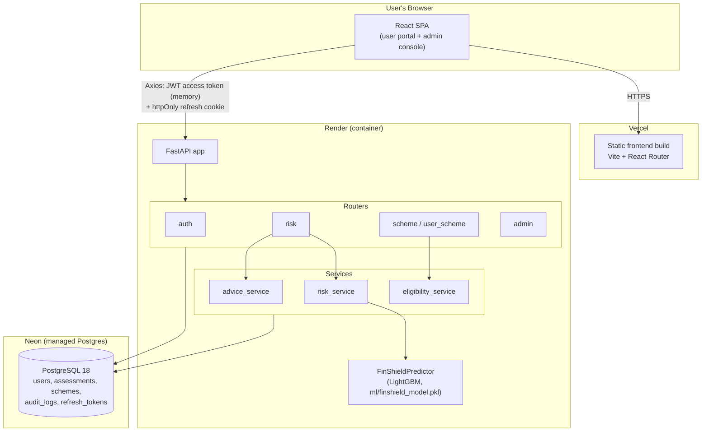
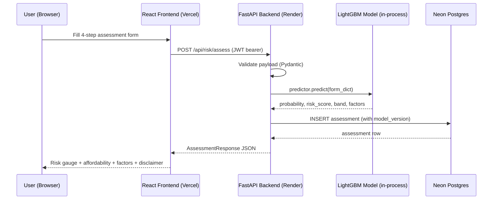

# FinShield — Context for Review-II PPT

This file summarizes the actual, verified state of the FinShield project as of
2026-09-11, for use as reference material when drafting the Review-II
presentation. Every claim below was checked against the running code or the
live deployment during development — nothing here is aspirational.

---

## 1. What FinShield Is

FinShield is a full-stack web application with two functions:

1. **Financial risk assessment** — a user fills a multi-step form about their
   personal, employment, and financial situation; a trained ML model returns
   a default-risk probability, a credit-score-style risk score, and a
   plain-language breakdown of what's driving the result.
2. **Government welfare scheme discovery** — users browse and get matched to
   Indian government welfare schemes (central and state) based on their
   profile, with a direct link to apply on the scheme's official portal.

The two features are intentionally decoupled: scheme browsing works even if
the ML service is unavailable.

---

## 2. System Architecture

| Layer | Technology |
|---|---|
| Frontend | React 19 + Vite, plain JavaScript (`.jsx`, no TypeScript), plain CSS Modules (no Tailwind/UI framework) |
| Routing | React Router v7 |
| HTTP client | Axios |
| Charts | Recharts |
| Backend | Python 3.11 + FastAPI + Pydantic v2 |
| ORM / migrations | SQLAlchemy 2.0 + Alembic |
| Database | PostgreSQL 18 (hosted on **Neon**, serverless Postgres) |
| Auth | JWT access tokens (15 min) + httpOnly refresh-token cookies (7 days), bcrypt password hashing |
| ML runtime | LightGBM |
| Rate limiting | slowapi |

### Deployment topology

- **Frontend** → Vercel (`finshield-three.vercel.app`)
- **Backend (FastAPI + ML)** → Render, a standard container-based web service
  (`finshield-backend-4un4.onrender.com`)
- **Database** → Neon (managed Postgres, serverless)

**Why the backend is not on Vercel:** it was originally deployed there and
failed outright (every request returned `500 FUNCTION_INVOCATION_FAILED`).
Root cause: Vercel serverless functions cap at 250MB unzipped; this backend's
ML dependencies alone (`lightgbm` + `pandas` + `scikit-learn` + `numpy` +
`scipy`) total ~256MB, before FastAPI/SQLAlchemy are even counted. Vercel is
architecturally unsuitable for a Python service bundling a real ML stack.
Render (a normal container, no such size cap) was used instead — this is a
legitimate, documented architectural decision, worth mentioning in a
"Design/System Architecture" slide as a real engineering trade-off that was
diagnosed and resolved, not just "we deployed it."

### Authentication design

Three login endpoints, all built on shared `_authenticate` / `_issue_session`
helpers in `backend/app/routers/auth.py`:

- `POST /api/auth/login` — role-agnostic; kept only because it's the OAuth2
  `tokenUrl` FastAPI's dependency injection uses internally.
- `POST /api/auth/login/user` — the customer portal login. Accepts any active
  account, admins included (an admin is also a user).
- `POST /api/auth/login/admin` — the admin console login. Returns 403 if the
  account's role isn't `admin`. Checks the password before the role, so a
  wrong password always returns 401 regardless of role — this prevents the
  403 response itself from leaking whether a password was correct.

The frontend has two separate login surfaces (`/login` and `/admin/login`)
sharing one `Auth.jsx` component via a `mode` prop.

### System architecture diagram

Deployment/component view — three independently hosted pieces talking over
HTTPS, with the ML model loaded in-process inside the backend rather than as
a separate service:

Request flow for a risk assessment, end to end:

Why this shape, for the review: the ML model is loaded once at backend
startup and served in-process (not as a separate microservice) — simplest
correct choice at this scale, and it's what makes the startup self-check
(section 3) possible, since the same process that serves predictions can
validate itself on boot. Scheme matching is a separate code path from risk
assessment (`eligibility_service`, not `risk_service`), which is what allows
scheme browsing to keep working independently of the ML pipeline.

---

## 3. The ML Model

**Algorithm:** LightGBM (`LGBMClassifier`, gradient-boosted decision trees).

**Hyperparameters:** 322 boosting rounds, 48 leaves per tree, learning rate
0.03, binary objective.

**Training data:** 307,511 rows. Population base default rate: 8.07%.

**Performance:**
| Metric | Value |
|---|---|
| AUC | 0.685 |
| Gini | 0.371 |
| KS statistic | 0.271 |
| Brier score | 0.071 |

Worth stating honestly in the review: AUC 0.685 is moderate, not strong, by
production credit-scorecard standards (0.75+ is typical for a deployed
scorecard). This is disclosed in-app — every result carries a disclaimer that
it is an indicative estimate, not a credit decision or financial advice.

**24 engineered features** fed to the model, derived from the user's 21 raw
form inputs (e.g. `owns_vehicle` → `OWNS_CAR`), including several derived
ratios: `DTI`, `DEBT_TO_INCOME`, `INCOME_PER_HEAD`, `INCOME_PER_YEAR_WORKED`,
`EMPLOYMENT_RATIO`. Categorical features: gender, education, marital status,
employment status, payment history.

**Output shape** (`FinShieldPredictor.predict()`):
- `default_probability` — raw model output
- `risk_score` — a 300–850 linear rescale of the probability onto a
  FICO-style range (`300 + (1 - prob/0.5) * 550`, clamped); higher = safer
- `risk_band` — one of 5 bands (Very Low/Low/Moderate/High/Very High) from
  fixed probability cutoffs baked into the model file; the frontend collapses
  these to 3 bands (Low/Medium/High) for display only — the model's own bands
  are never altered
- `population_percentile`
- `affordability` block — grade, monthly surplus, surplus ratio,
  EMI-to-income ratio, emergency fund months, flags
- `factors` — plain-language positive/negative drivers of the score

**The model file (`ml/finshield_model.pkl`) is frozen** — it cannot be
retrained in this environment; the 700MB training dataset isn't included in
the repo. A startup self-check runs a fixed sample input on every backend
boot and logs a critical error if the output drifts from the expected value
(`0.0232`), to catch a dependency version mismatch silently corrupting
predictions.

---

## 4. Scheme Recommendation Engine

- Eligibility rules are stored per scheme as `(field, operator, value,
  logic_group)` tuples, evaluated against the user's profile.
- Groups combine with AND; multiple groups combine with OR (so a scheme can
  have more than one eligibility path — e.g. "SC/ST OR women entrepreneurs").
- `POST /api/schemes/match` — full-profile matching (logged-in users, uses
  the assessment data).
- `POST /api/schemes/quick-match` — lighter matching (works without login,
  fewer fields) — this is what keeps scheme discovery independent of the ML
  service.
- Every scheme card links directly to the scheme's real official application
  URL (`official_url` field) — this app does not build a government
  application flow itself; it links out, by design.

### Data status (the honest bottleneck)

| Status | Count | Meaning |
|---|---|---|
| `active` (visible to users) | 8 | Real, sourced, verified schemes |
| `needs_review` (built, not yet visible) | 11 | Real schemes sourced from official government sources (PIB press releases, ministry sites), pending admin review before going live |
| `archived` | 17 | **Removed fabricated placeholder data** — see below |

**Important context for the review:** the project originally shipped with 17
fake "State Welfare Scheme 9–25" entries — invented benefit amounts, a
generic non-scheme URL, and descriptions that literally read "This is a
placeholder" — live and shown to users as real schemes. These were identified
and archived. The 11 replacement schemes were individually sourced from
official Indian government press releases (`pib.gov.in`), not generated from
memory, specifically to avoid repeating that mistake — each has a real
eligibility basis and a real official application link. This is a legitimate
data-integrity story worth including in the review: the project has an actual
content-moderation workflow (`needs_review` → admin-approved → `active`), not
just a static seed file.

Schemes currently active (sourced from the original seed):
PM-KISAN, PMAY (Urban), Sukanya Samriddhi Yojana, Atal Pension Yojana,
PM Mudra Yojana, NSP Post-Matric Scholarship, Ayushman Bharat (PM-JAY),
Stand-Up India.

Schemes sourced and pending review: PM Ujjwala Yojana, PMJJBY, PMSBY,
PM Fasal Bima Yojana, PM Vishwakarma, PMEGP, PM SVANidhi, NMMSS
(National Means-cum-Merit Scholarship), PMMVY (Matru Vandana Yojana),
PM Jan Dhan Yojana, Pre-Matric Scholarship for SC students.

---

## 4a. Project Outcomes — What a User Actually Gets

This is the "Results" section for the paper — what the system delivers
end-to-end, not just the model's raw JSON output.

**Flow a real user goes through:**
1. Registers/logs in (separate user and admin login portals, JWT access +
   httpOnly refresh-token cookie session).
2. Fills a 4-step risk assessment wizard (personal details → employment/
   assets → finances → credit history), with conditional fields (e.g. EMI/
   loan-balance inputs only appear if the user has active loans) and inline
   validation.
3. On submit, the backend calls the frozen LightGBM model and returns, within
   the same request, both the ML risk result and automatically ranked welfare
   scheme matches — the two modules work together in one flow even though
   they're independently functional.
4. **Risk Result screen** shows: a 300–850 gauge-style score with a 3-band
   color label (Low/Medium/High), the default probability and population
   percentile ("safer than X% of a reference population of 307,511
   applicants"), an affordability breakdown (monthly surplus, EMI-to-income
   ratio, emergency-fund-months), plain-language positive/negative factors
   driving the result, and a mandatory disclaimer that this is an indicative
   estimate from FinShield's trained ML model, not a credit decision or
   licensed financial advice.
5. **Scheme matches**: ranked list of government welfare schemes the user is
   currently eligible for, each with eligibility criteria shown and a link to
   the official government application portal (the app deliberately does not
   build its own application flow — see Out of Scope).
6. **Reports/History**: logged-in users can revisit past assessments; an
   admin console lets an admin manage scheme records (draft/active/archived/
   needs_review lifecycle) independent of the ML side.

**Outcome in one line for the abstract:** a single web application where a
user gets both an ML-backed, explainable credit-risk indication and a
personalized, linked list of government schemes they qualify for — two
problems (credit opacity and welfare scheme under-discovery) addressed in one
flow, each usable even if the other component fails (per Rule 8 in
AGENTS.md: scheme browsing works independent of the ML service).

**What to quantify in the Results section of the paper**, pulling from this
file: model metrics (section 3's table), scheme coverage honestly (8
active / 11 pending review, section 4), test coverage (20 pytest + 46 API
smoke checks, section 6), and the bug-fix list (section 5) as evidence of a
working, hardened system rather than a prototype that only runs once.

---

## 5. Notable Bugs Found and Fixed This Cycle

Useful for a "Partial Implementation/Results" slide — shows engineering
rigor, not just feature-building:

1. **Assessment submission silently failed for every user without prior
   credit history.** The frontend sent `payment_history: "No History"`; the
   backend only accepted `"no_history"`. Every such submission was rejected
   before the ML model ever ran.
2. **That failure crashed the page to a blank white screen** instead of
   showing an error — FastAPI's 422 validation errors return an array of
   error objects, and the code tried to render that array directly as React
   children, which React refuses to do. Fixed with a proper error-formatting
   helper.
3. **Risk gauge showed a "Low Risk" label while the needle pointed at the red
   (high-risk) end of the dial** — traced via the SVG rotation math: the
   needle sweep direction was correct, but the color gradient was reversed.
4. **A committed secret**: an early commit included a real database
   password and JWT signing key in a tracked `.env` file, pushed to the
   public GitHub repo. Rotated, and the file moved to a gitignored location.
5. **Reserved-TLD email trap**: an admin account seeded with a
   `.local`-domain email address could log in with correct credentials but
   the server crashed with a 500 on every response, because Pydantic's
   `EmailStr` validator rejects reserved TLDs even on output serialization.
6. **`bcrypt`/`passlib` version incompatibility broke all logins on the fresh
   Render deployment** — `bcrypt>=4.1` raises on inputs over 72 bytes instead
   of silently truncating them (its old behavior), which crashed `passlib`
   1.7.4's own internal self-test on first use. Fixed by pinning
   `bcrypt==4.0.1`; verified in a clean virtual environment before deploying.
7. **A per-user data leak**: the risk-assessment wizard's draft (in-progress
   form data, including income and debt figures) was stored under one global
   `localStorage` key shared by every account on the same browser — so
   logging in as a second user showed the first user's unsaved financial
   data. Fixed by scoping the draft key to the logged-in user's ID and
   clearing it on logout.

---

## 6. Testing / Verification Infrastructure

- **Backend**: pytest suite (20 tests) covering auth (registration, login —
  all three endpoints, refresh-token rotation and revocation, role
  enforcement) and risk assessment, run against an isolated SQLite DB.
- **API smoke test** (`frontend/scripts/api-smoke-test.mjs`, `npm run
  test:api`): a standalone Node script hitting every backend endpoint on a
  live server — 46 checks covering auth, risk assessment, schemes,
  user-schemes, and admin routes, including negative cases (401/403/422).
  Zero dependencies.
- All fixes above were verified against the live production deployment
  (Render + Neon + Vercel) with real HTTP requests, not just locally.

---

## 7. What's Explicitly Out of Scope

Per the project's own constraints: payment processing, real government
portal API integration (the app links out to official portals instead of
building its own application flow), SMS/OTP delivery, a mobile app.

---

## 8. Suggested Framing for Review-II Slides

- **Objective**: two independent, functional modules — ML-based risk
  scoring and government scheme discovery — for financial inclusion.
- **Design/System Architecture**: use section 2 above; the Vercel→Render
  migration is a genuine, presentable architecture decision (diagnosed a
  real constraint, chose the right tool for a Python+ML workload).
- **Partial Implementation/Results**: use sections 3, 5, and 6 — a working
  deployed system with a real trained model (cite the AUC/Gini/KS numbers),
  a documented bug-fixing process, and automated test coverage is stronger
  evidence of "partial implementation" than most capstones show at this
  stage.
- **Honest gap to name explicitly** (don't let a reviewer find it first):
  scheme data coverage is early — 8 live, 11 more sourced and pending
  review, against an eventual goal of much broader coverage. Framing this as
  a deliberate data-integrity choice (reviewed data only, no fabricated
  entries) is a stronger story than hiding the gap.

---

## 9. Screenshots — Not Included Here, But You Should Add Them

This is a text file with no images embedded. For both the slide deck and the
paper, take real screenshots of the live app yourself and drop them in
wherever a "Fig." reference appears — don't let a downstream Claude session
invent or describe placeholder UI. Minimum set worth capturing:

1. Landing page (shows the Admin Login / User Login split).
2. The assessment wizard — at least one step with the conditional loan
   fields visible (demonstrates the fixed mandatory-field bug).
3. The Risk Result screen — gauge, score, band label, affordability block,
   disclaimer text all visible in one shot.
4. The scheme match list — a card showing eligibility criteria and the
   official application link.
5. The admin console's scheme management table (draft/active/needs_review
   status visible) — shows the data-integrity workflow, not just the
   end-user side.
6. Optional: the Reports/history page, and a terminal screenshot of the
   pytest + API smoke-test run (see section 6) as evidence of the test
   infrastructure, if the paper's venue expects that kind of proof.

Use real data/test accounts, not production users' real financial figures,
per the "never log financial values" rule — screenshots are also a form of
exposure, so use test or dummy accounts when capturing these.
