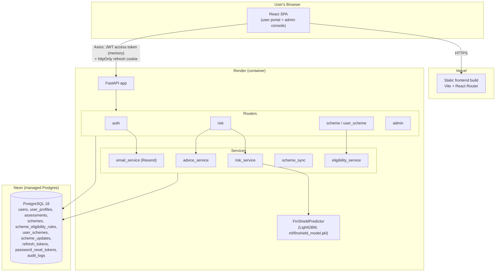
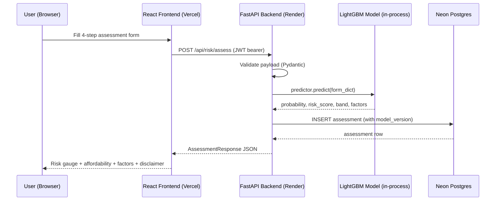
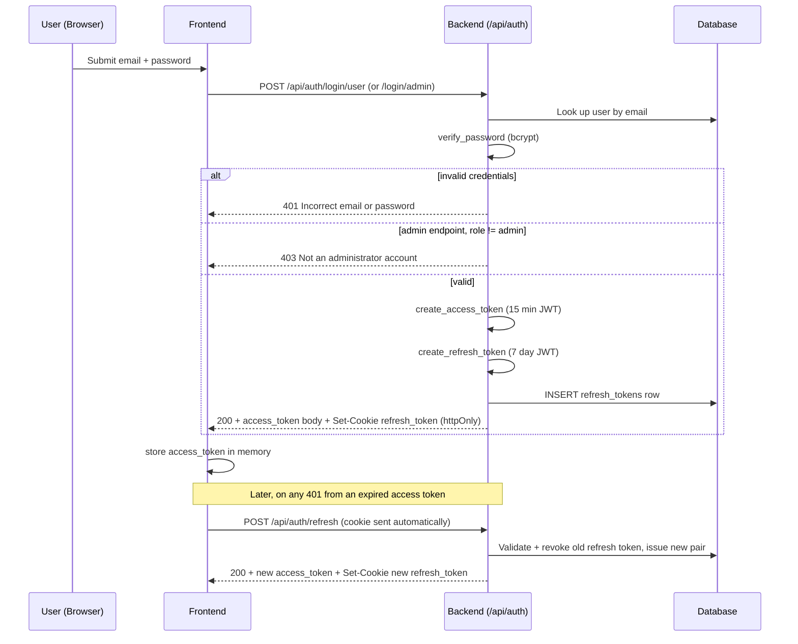
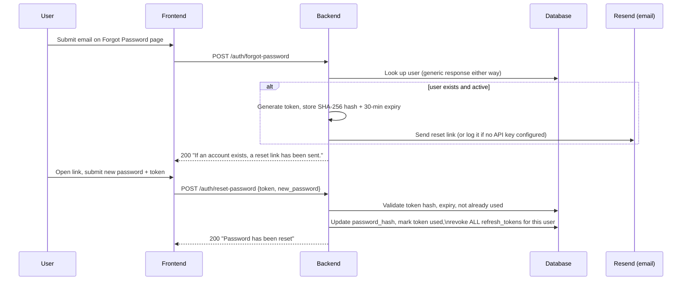

# FinShield — Master Reference for Documentation (Interim Report / Black Book / Project Report)

This file is a complete, verified reference to the FinShield project, written to
be handed to an AI assistant (or a person) who needs to produce formal academic
documentation — interim report, final "black book," synopsis, or any other
report format — without inventing facts. Every technical claim below was
checked against the actual source code, database schema, or live deployment
as of 2026-10-19. Where something is incomplete or a known limitation, it is
stated honestly rather than rounded up, because a report that overclaims is a
worse outcome than one that is precise about partial work.

**Instruction to whichever AI is given this file**: use only the facts in this
document. Where you need content this file doesn't contain (literature survey
citations, a specific formatting template your institute requires, the
author's name/roll number/college name, submission date), ask the user rather
than inventing it. Do not invent performance numbers, dataset sizes, citation
titles, or screenshots — the user will supply or capture those separately.

---

## 1. Project Identity

- **Project title**: FinShield — AI-Based Financial Risk Assessment and
  Government Welfare Scheme Recommendation System
- **Domain**: FinTech / Financial Inclusion, applied Machine Learning,
  E-Governance.
- **Type of project**: Full-stack web application (not a research-only ML
  notebook) — a deployed, usable system with a persistent database, real
  authentication (including password reset and session management), and a
  live frontend/backend split across cloud hosts.
- **Core idea**: one application solving two related but independent problems
  for a financially underserved user:
  1. *Opacity of credit risk* — most people have no way to see an estimate of
     their own credit risk before applying for a loan. FinShield gives an
     ML-generated, explainable estimate instead of a black-box bank decision.
  2. *Under-discovery of government welfare schemes* — India runs 500+
     central and state welfare schemes, but awareness and eligibility
     matching are poor. FinShield matches a user's own profile against a
     curated set of real schemes and links directly to the official
     application portal.
- **Why these two together**: both target the same underserved user
  (someone assessing their financial standing), and both are framed as
  *decision-support*, not decision-making — the app never approves a loan or
  submits a government application; it informs and links out.

---

## 2. Problem Statement

Individuals — particularly first-time borrowers, gig workers, and rural or
semi-urban applicants with thin credit files — lack two things:
1. Any visibility into how a lender's credit model might view their
   financial profile before they formally apply (and suffer a hard credit
   inquiry or rejection).
2. An easy way to discover which of the many Indian government welfare
   schemes they currently qualify for, since eligibility rules are scattered
   across hundreds of individual scheme pages and press releases.

FinShield addresses both with a single authenticated web app: a guided
assessment form that returns an ML-based risk indication, and a scheme
matching engine that runs against the same (or a lighter, login-free)
profile.

## 3. Objectives

1. Build a multi-step web form that collects the financial/demographic data
   needed for a credit-risk ML model, with proper client- and server-side
   validation.
2. Integrate a pre-trained LightGBM classifier to produce a default-risk
   probability, a FICO-style risk score, a risk band, and human-readable
   explanatory factors — without retraining or altering the model.
3. Build a rules-based eligibility engine that matches a user profile against
   a database of real government welfare schemes and ranks the matches.
4. Implement secure authentication with separate login surfaces for regular
   users and administrators, using industry-standard JWT + refresh-token
   session handling, plus a real password-reset flow and user-manageable
   active sessions.
5. Give administrators a console to manage the scheme dataset's lifecycle
   (draft → needs_review → active → archived) so scheme data quality is
   maintained over time rather than being a static seed file.
6. Deploy the system to the public internet on production-grade hosting
   (not just `localhost`), and verify it with automated tests against the
   live deployment, not only a local dev environment.

## 4. Scope

**In scope**: the ML-based risk assessment flow; the scheme discovery and
matching flow; user and admin authentication (including password reset and
session management); a user profile with an editable photo; an admin console
for scheme data management; automated backend tests and an API-level smoke
test; deployment to a live, publicly reachable URL.

**Explicitly out of scope** (stated up front, not a late excuse):
- Payment processing of any kind.
- Real government portal API integration — the app links to the scheme's
  official application page rather than submitting an application itself.
- SMS/OTP delivery.
- A native mobile application (the frontend is a responsive web SPA only).
- Retraining or modifying the ML model — the model file is treated as a
  frozen, externally-supplied artifact (see Section 8).
- Self-service admin account creation — a deliberate security decision, see
  Section 5.2.

---

## 5. System Architecture

| Layer | Technology | Notes |
|---|---|---|
| Frontend | React 19 + Vite | Plain JavaScript (`.jsx`), **no TypeScript** |
| Styling | Plain CSS Modules | No Tailwind, no Bootstrap, no Material UI — a deliberate project constraint |
| Routing | React Router v7 | Client-side SPA routing |
| HTTP client | Axios 1.20 | Interceptor handles silent access-token refresh on 401 |
| Charts | Recharts 3.10 | Used for the risk gauge / result visualizations |
| Backend | Python 3.11, FastAPI | Async-capable REST API, Pydantic v2 for validation |
| ORM | SQLAlchemy 2.0 | Pinned `<2.1` — see Section 11, item 9 for why this matters |
| Migrations | Alembic | Schema versioning |
| Database | PostgreSQL 18 | Hosted on **Neon** (serverless managed Postgres) |
| Auth | JWT (PyJWT) + bcrypt | 15-minute access tokens, 7-day httpOnly refresh-token cookies, bcrypt password hashing (pinned to `bcrypt==4.0.1`) |
| Email | Resend (HTTP API via `httpx`) | Password-reset links; logs the link server-side instead of failing if unconfigured |
| Rate limiting | slowapi | Per-route limits, e.g. 5/min on register, forgot-password, and reset-password |
| ML runtime | LightGBM 4.7.0 | Loaded in-process inside the FastAPI app, not a separate microservice |
| Testing | pytest + httpx (backend, 29 tests), a zero-dependency Node smoke-test script (46 API-level checks) | See Section 12 |

### 5.1 Deployment topology

- **Frontend** → **Vercel** (static build, `finshield-three.vercel.app`)
- **Backend (FastAPI + ML)** → **Render** (container-based web service,
  `finshield-backend-4un4.onrender.com`)
- **Database** → **Neon** (managed, serverless Postgres)

Three independently hosted, independently scalable pieces communicating over
HTTPS.

**Why the backend is on Render, not Vercel — a real architectural decision
worth documenting, not a footnote.** The backend was originally deployed to
Vercel and failed outright: every request returned
`500 FUNCTION_INVOCATION_FAILED`. Root cause, diagnosed from the actual
deployment logs: Vercel serverless functions have a hard 250MB unzipped size
cap, and this backend's ML dependency stack alone (`lightgbm` + `pandas` +
`scikit-learn` + `numpy` + `scipy`) totals roughly 256MB — before FastAPI,
SQLAlchemy, or anything else is even counted. Vercel's serverless-function
model is architecturally unsuited to a Python service that bundles a real ML
runtime. Render was chosen instead specifically because it runs a normal
long-lived container with no such artificial size ceiling. This is presented
in the report as a diagnosed constraint and a justified tool choice, not as
"we deployed it and it didn't work the first time."

**Render's free-tier cold start is a real, ongoing constraint worth naming.**
After ~15 minutes without traffic, Render spins the backend container down;
the next request has to cold-boot a Python process that imports
`pandas`/`scikit-learn`/`lightgbm`, which can take 30-60+ seconds. This isn't
fixable with more application code — it's a hosting-tier limit. What *was*
fixable (and was fixed) was a frontend bug that made this worse than it had
to be: the app used to block its entire first render, including the public
landing page, behind a network call that waited out the cold start even for
visitors who weren't logging in at all. See Section 11, item 10.

**Cross-site cookie handling.** Because the frontend (Vercel) and backend
(Render) are different registrable domains, the refresh-token cookie's
`SameSite` attribute matters: `SameSite=Lax` (the safe local-dev default) is
never attached by browsers to a cross-site XHR/fetch call, which silently
broke session refresh in production until the cookie attributes were made
configurable (`COOKIE_SECURE=true`, `COOKIE_SAMESITE=none` in production,
`false`/`lax` in local dev) — see Section 11, item 8.

### 5.2 Authentication, password reset, and session design

Three login endpoints share two internal helpers (`_authenticate`,
`_issue_session`) in `backend/app/routers/auth.py`:

- `POST /api/auth/login` — role-agnostic; retained only because it is the
  OAuth2 `tokenUrl` that FastAPI's own dependency-injection security scheme
  expects internally.
- `POST /api/auth/login/user` — the customer-facing portal login. Accepts
  any active account, including admin accounts (an admin is also a user and
  can use the regular dashboard).
- `POST /api/auth/login/admin` — the admin console login. Returns `403` if
  the authenticated account's role is not `admin`. Deliberately checks the
  password *before* the role check, so an incorrect password always returns
  `401` regardless of role — this prevents the endpoint's response from
  leaking whether a given email belongs to an admin account.

Session mechanics: a 15-minute JWT access token (kept in frontend memory, not
localStorage, to limit XSS exposure) plus a 7-day refresh token stored
**both** as an httpOnly cookie (inaccessible to JavaScript) and as a database
row in `refresh_tokens` (so a token can be explicitly revoked server-side on
logout or rotation, not just left to expire). On every refresh, the old
token is marked `revoked=True` and a new one is issued (rotation, not reuse).

**Admin accounts are never self-service, by design.** There is no public
"create admin" button anywhere in the UI, and this is a deliberate security
decision, not an oversight — exposing one would let any internet visitor
grant themselves administrator access. The actual workflow: a person signs
up as a regular user through the normal public Sign Up form, and a project
owner with direct database/server access runs
`backend/scripts/create_admin.py <email>` to promote that one specific
account's `role` to `admin`. This is worth a sentence in a "Security Design"
section — a system-level safeguard, not a missing feature.

**Password reset** (`POST /auth/forgot-password`, `POST /auth/reset-password`)
is a real, token-based flow, not a form that just looks functional:
- A single-use, SHA-256-hashed, 30-minute-expiry token is generated and
  stored in the `password_reset_tokens` table (never the raw token, mirroring
  how passwords themselves are never stored in plaintext).
- The reset link is emailed via Resend's HTTP API; if no `RESEND_API_KEY` is
  configured (e.g. local development), the link is logged server-side
  instead of the request silently failing.
- The forgot-password response is identical whether or not the submitted
  email belongs to a real account, so the endpoint cannot be used to
  enumerate registered users.
- A successful reset revokes **every** existing refresh-token session for
  that account, not just the current device — a password reset is a signal
  that prior sessions should no longer be trusted.

**Active session management** ("Security Log" in the UI) is backed by
`GET /api/auth/sessions` and `DELETE /api/auth/sessions/{id}`, both scoped to
the authenticated user's own `refresh_tokens` rows (verified in testing that
one user cannot revoke another user's session — see Section 12).

### 5.3 Architecture diagrams

**Component / deployment view:**



**Risk-assessment request sequence:**



**Authentication / session sequence:**



**Password reset sequence:**



Why this shape, for the review: the ML model is loaded once at backend
startup and served in-process (not as a separate microservice) — simplest
correct choice at this scale, and it's what makes the startup self-check
(Section 8.5) possible, since the same process that serves predictions can
validate itself on boot. Scheme matching is a separate code path from risk
assessment (`eligibility_service`, not `risk_service`), which is what allows
scheme browsing to keep working independently of the ML pipeline.

---

## 6. Technology Justification (for a "System Requirements" / "Feasibility" chapter)

- **FastAPI over Flask/Django**: native async support, automatic OpenAPI
  schema generation (`/docs`), and first-class Pydantic v2 integration for
  request/response validation — directly useful for a form-heavy app with a
  strict model input contract (Section 8.3).
- **React + Vite over Create React App**: Vite's dev server and build are
  materially faster; CRA is effectively unmaintained upstream.
- **Plain CSS Modules over a CSS framework**: a project constraint (see
  `AGENTS.md` in the repo) to keep the frontend dependency-light and to force
  deliberate, from-scratch design-token decisions (documented color/spacing
  variables) rather than relying on a framework's defaults.
- **PostgreSQL over MySQL/SQLite in production**: native `JSONB` columns
  (used for `input_data`, `affordability`, `factors`, eligibility rule
  `value`, and `changes` in the audit log) and proper `UUID` primary keys.
  SQLite is used only as an isolated, fast backend for the automated test
  suite (Section 12), never in production — and this distinction mattered in
  practice: a timezone-handling bug in the password-reset flow passed every
  local test against SQLite but crashed against the real Postgres database,
  because the two return differently-shaped datetime objects (see Section
  11, item 11).
- **Neon over a self-managed Postgres instance**: serverless, scales to
  zero, no server to patch or back up manually — appropriate for a student
  project's budget and operational capacity.
- **LightGBM over logistic regression or a deep model**: gradient-boosted
  trees handle the mixed categorical/numeric tabular features in this
  domain well, train fast, and — critically for this project — the model
  was supplied pre-trained and is treated as a fixed, frozen artifact, so the
  choice of algorithm itself is inherited, not re-derived; see Section 8.
- **JWT + httpOnly refresh cookie over a single long-lived token**: limits
  the exposure window of a stolen access token (15 minutes) while the
  refresh token — the more sensitive, longer-lived credential — is
  inaccessible to any JavaScript on the page (httpOnly), mitigating XSS
  token theft.
- **Resend over SMTP or a heavier email platform**: a simple HTTP API call
  (no SMTP server/credentials to manage), with a sensible fallback
  (server-side logging) when unconfigured, so the password-reset flow is
  fully testable in local development without requiring every developer to
  have email credentials.

---

## 7. Database Design

Ten tables, all UUID-keyed. This is the actual, current SQLAlchemy schema —
suitable for direct inclusion as an ER diagram or schema table in the report.

### 7.1 Entities

**`users`**
| Column | Type | Notes |
|---|---|---|
| id | UUID, PK | |
| email | String, unique, indexed | |
| phone | String, nullable | |
| full_name | String, nullable | |
| avatar_data | String, nullable | A `data:image/...;base64,...` URI, size-capped and server-validated; no object storage is set up for this project, so the photo lives directly in this column |
| password_hash | String | bcrypt hash, never the plaintext |
| role | Enum(`user`, `admin`) | default `user`; never set to `admin` by any public-facing endpoint |
| is_verified | Boolean | |
| is_active | Boolean | default True; `_authenticate` rejects login if False |
| created_at / updated_at | DateTime (tz-aware) | |

**`user_profiles`** (1:1 with `users`)
| Column | Type | Notes |
|---|---|---|
| id | UUID, PK | |
| user_id | UUID, FK → users.id, unique | |
| date_of_birth | Date, nullable | |
| gender | String, nullable | |
| state / district | String, nullable | for scheme matching by geography |
| area_type | Enum(`rural`, `urban`) | |
| occupation_tags | JSON, nullable | |

**`refresh_tokens`**
| Column | Type | Notes |
|---|---|---|
| id | UUID, PK | |
| token | String, unique, indexed | the JWT string itself |
| user_id | UUID, FK → users.id | |
| expires_at | DateTime (tz-aware) | |
| revoked | Boolean | flipped True on rotation/logout/password reset |
| created_at | DateTime | surfaced to the user as session "start time" on the Security Log page |

**`password_reset_tokens`**
| Column | Type | Notes |
|---|---|---|
| id | UUID, PK | |
| user_id | UUID, FK → users.id | |
| token_hash | String, unique, indexed | SHA-256 hash of the emailed token — the raw token is never stored, mirroring password handling |
| expires_at | DateTime (tz-aware) | 30 minutes from issuance |
| used | Boolean | single-use enforcement |
| created_at | DateTime | |

**`assessments`**
| Column | Type | Notes |
|---|---|---|
| id | UUID, PK | |
| user_id | UUID, FK → users.id | |
| created_at | DateTime | indexed together with user_id, DESC, for fast "recent reports" queries |
| input_data | JSONB | the full form submission, for traceability |
| default_probability | Float | raw model output |
| risk_band | String | one of the model's 5 bands |
| risk_score | Integer | 300–850 |
| population_percentile | Float | |
| affordability | JSONB | grade, surplus, ratios, flags |
| factors | JSONB | positive/negative plain-language drivers |
| model_version | String | **every stored prediction records the model version**, per the project's traceability rule |

**`schemes`**
| Column | Type | Notes |
|---|---|---|
| id | UUID, PK | |
| name / slug | String | slug is unique, used in the scheme-detail URL |
| short_description / full_description | String / Text | |
| ministry | String, nullable | |
| category | Enum(`education`, `health`, `agriculture`, `business`), nullable | nullable because several real schemes (e.g. direct cash-transfer or girl-child savings schemes) don't cleanly fit any of the four categories |
| level | Enum(`central`, `state`) | |
| state | String, nullable | only set for state-level schemes |
| benefit_type | Enum(`cash`, `subsidy`, `insurance`, `loan`, `other`) | |
| benefit_amount | Numeric, nullable | |
| official_url | String | the real government link the user is sent to |
| required_documents | JSONB | |
| status | Enum(`draft`, `active`, `archived`, `needs_review`) | governs visibility — only `active` is ever returned to end users |
| source_url | String, nullable | where the scheme data was sourced from, for auditability |
| last_synced_at | DateTime, nullable | |

**`scheme_eligibility_rules`**
| Column | Type | Notes |
|---|---|---|
| id | UUID, PK | |
| scheme_id | UUID, FK → schemes.id | |
| field | String | which profile/assessment field this rule checks |
| operator | Enum(`eq`,`neq`,`lt`,`lte`,`gt`,`gte`,`between`,`in`,`not_in`) | |
| value | JSONB | the comparison value(s) |
| logic_group | Integer | rules in the same group are AND'ed; groups are OR'ed across each other |

**`user_schemes`**
| Column | Type | Notes |
|---|---|---|
| id | UUID, PK | |
| user_id | UUID, FK → users.id | |
| scheme_id | UUID, FK → schemes.id | |
| status | Enum(`saved`,`documents_ready`,`applied`,`under_review`,`approved`,`rejected`) | user's own tracked progress |
| notes | Text, nullable | |
| application_number | String, nullable | |
| *(unique constraint on user_id+scheme_id — a user can only track a given scheme once)* | | |

**`scheme_updates`**
| Column | Type | Notes |
|---|---|---|
| id | UUID, PK | |
| scheme_id | UUID, FK → schemes.id | |
| detected_at | DateTime | |
| source_url | String, nullable | |
| field_changes | JSONB | what changed |
| status | Enum(`pending`,`approved`,`rejected`) | admin review queue for scheme data drift |
| reviewed_by | UUID, FK → users.id, nullable | |

**`audit_logs`**
| Column | Type | Notes |
|---|---|---|
| id | UUID, PK | |
| actor_id | UUID, FK → users.id, nullable | who did it |
| action | String | e.g. "scheme.status_changed" |
| entity_type / entity_id | String | what was acted on |
| changes | JSONB, nullable | |
| ip_address | String, nullable | |

### 7.2 Relationships (for an ER diagram)

- `users` 1—1 `user_profiles`
- `users` 1—N `assessments`
- `users` 1—N `refresh_tokens`
- `users` 1—N `password_reset_tokens`
- `users` 1—N `user_schemes` N—1 `schemes` (many-to-many between users and
  schemes via the `user_schemes` join table, which also carries per-user
  state)
- `schemes` 1—N `scheme_eligibility_rules`
- `schemes` 1—N `scheme_updates`
- `users` 1—N `audit_logs` (as actor)

---

## 8. The Machine Learning Module

### 8.1 Position in the system

The ML model is a **pre-trained, frozen artifact** (`ml/finshield_model.pkl`)
loaded once at backend startup and served in-process inside the FastAPI
application — not as a separate microservice. It is explicitly never
retrained, refit, or modified as part of this project's engineering work;
the project's own `AGENTS.md` instructions state this as a hard rule,
because the 700MB training dataset is not present in the repository and
cannot be regenerated in this environment. **This is an important, honest
scoping statement for the report**: the contribution of this project is the
*system* built around the model (data pipeline, API contract, explainable
output, UI, affordability analysis, the self-check in Section 8.5) — not the
training of the model itself. State this plainly rather than implying the
model was trained as part of this capstone, unless you in fact also did the
training work separately (`step1_*.py`–`step4_*.py` scripts exist in the
repo for that original training process, kept for academic reproducibility,
but they require source CSVs not included here and are never run as part of
the live application).

### 8.2 Algorithm and training details

- **Algorithm**: Gradient-boosted decision trees via LightGBM's
  `LGBMClassifier`.
- **Hyperparameters**: 322 boosting rounds (estimators), 48 leaves per tree,
  learning rate 0.03, binary classification objective.
- **Training data**: 307,511 rows. Population base default rate: 8.07%.
- **Performance metrics**:

  | Metric | Value | Plain-language meaning |
  |---|---|---|
  | AUC (ROC) | 0.685 | Probability the model ranks a random defaulter as riskier than a random non-defaulter, better than chance (0.5) but moderate by production credit-scorecard standards (0.75+ is typical in deployed scorecards) |
  | Gini coefficient | 0.371 | Equivalent to `2×AUC − 1`; a standard credit-scoring discrimination metric |
  | KS statistic | 0.271 | Maximum separation between the cumulative good/bad distributions |
  | Brier score | 0.071 | Mean squared error of the predicted probability — lower is better; a well-calibrated model with low error |

  **State this honestly in the report**: AUC 0.685 reflects moderate, not
  strong, discrimination. The in-app disclaimer (every result includes one)
  exists specifically because of this — framing the output as an indicative
  estimate, never a credit decision.

### 8.3 Features

21 raw fields are collected from the user via the 4-step form and sent to
the API:

```
age, gender, education, marital_status, dependents, employment_status,
years_employed, annual_income, monthly_emi, existing_total_debt, asset_value,
monthly_expenditure, savings, owns_vehicle, owns_property, has_prior_credit,
has_defaulted, payment_history, n_prior_credits, n_active_credits,
years_credit_history
```

These are transformed by `finshield_predictor.py`'s frozen feature
engineering into **24 engineered features**, including derived ratios such
as `DTI`, `DEBT_TO_INCOME`, `INCOME_PER_HEAD`, `INCOME_PER_YEAR_WORKED`,
`EMPLOYMENT_RATIO`, plus categorical encodings of gender, education, marital
status, employment status, and payment history. Dropdown option values are
served by `GET /api/risk/schema` so the frontend never hardcodes a
mismatched set of valid category values (a mismatch here was in fact one of
the real bugs fixed — see Section 11, item 1).

### 8.4 Output contract

`FinShieldPredictor.predict(form_dict)` returns exactly this shape, and the
frontend renders these fields and no invented ones:

```json
{
  "default_probability": 0.0942,
  "risk_band": "Moderate",
  "risk_score": 641,
  "population_percentile": 62.0,
  "affordability": {
    "grade": "Stretched",
    "monthly_surplus": 12000.0,
    "surplus_ratio": 0.16,
    "emi_to_income_ratio": 0.42,
    "emergency_fund_months": 2.8,
    "flags": ["EMIs are above the 40% comfort threshold"]
  },
  "factors": {
    "positive": ["Stable employment record"],
    "negative": ["Existing EMIs consume a large share of income"]
  },
  "model_meta": {
    "auc": 0.6853,
    "trained_on": 307511,
    "population_default_rate": 0.0807
  }
}
```

- `risk_score`: a 300–850 linear rescale of the default probability onto a
  FICO-style range: `risk_score = 300 + (1 - probability/0.5) * 550`,
  clamped to `[300, 850]`. Higher score = lower risk (safer).
- `risk_band`: one of **five** bands — Very Low, Low, Moderate, High, Very
  High — determined by fixed probability cutoffs baked into the model
  (`[0.0657, 0.1039, 0.1525, 0.2108]`). The **frontend** collapses these to
  **three** display bands (Low = Very Low+Low, Medium = Moderate, High =
  High+Very High) purely for UI simplicity. This collapsing happens only in
  the frontend; the model's own five-band output is never altered, logged,
  or stored differently — an explicit project rule.
- `affordability`: a **separate, deterministic heuristic** (not part of the
  ML model's output) computed from the same inputs — monthly surplus,
  surplus ratio, EMI-to-income ratio, emergency-fund-months, and flags.

  **This distinction was empirically confirmed during this development
  cycle, not just asserted.** A real user's assessment showed `risk_band:
  "Low"` (score 775, probability 6.9%) alongside an `affordability.grade:
  "Critical"` with a negative monthly surplus — which looked like a
  contradiction. Investigation pulled the actual stored `input_data` from
  the database: the profile had no prior credit, no defaults, and
  `payment_history: "no_history"`. Resubmitting the *exact same* profile
  against the live production API with only those three credit-history
  fields changed to risky values (`has_prior_credit: true, has_defaulted:
  true, payment_history: "poor"`) returned `risk_band: "Very High"`,
  `risk_score: 300`. This confirms the model weighs credit-history behavior
  far more heavily than raw income/expenditure numbers — which the
  affordability panel captures separately and correctly. Worth a sentence in
  the paper's Discussion or Limitations section to pre-empt a reader seeing
  this as inconsistent output.

### 8.5 Integrity safeguard

A startup self-check runs a fixed sample input through the loaded model on
every backend boot and logs a critical error if the output drifts from a
known expected value (`0.0232`). This exists to catch a dependency version
mismatch (e.g. a different LightGBM version loaded, which can silently
change prediction outputs without raising any exception) corrupting live
predictions — worth including in a report as evidence of production
engineering discipline around a third-party ML artifact, not just "the model
works." The same category of problem (an unpinned dependency silently
changing behavior on a fresh install) also broke the backend's database
driver entirely at one point — see Section 11, item 9 — reinforcing why this
kind of defensive check matters for the whole stack, not just the model.

---

## 9. Scheme Recommendation Engine

### 9.1 Design

- Each scheme's eligibility is defined by rows in `scheme_eligibility_rules`:
  `(field, operator, value, logic_group)`.
- Rules sharing a `logic_group` combine with **AND**; separate groups combine
  with **OR** — so a scheme can express multiple independent eligibility
  paths (e.g. "SC/ST applicants OR women entrepreneurs OR annual income below
  ₹X").
- `evaluate_scheme` / `rank_schemes` in `eligibility_service.py` perform the
  evaluation against a user's profile/assessment data and return a ranked
  list.

### 9.2 Endpoints

- `GET /api/schemes` — list active schemes (filterable by category, level,
  state, benefit_type, and free-text search via `q`).
- `GET /api/schemes/{slug}` — scheme detail.
- `POST /api/schemes/match` — full-profile matching for logged-in users
  (uses assessment data for richer matching).
- `POST /api/schemes/quick-match` — a lighter match that works **without
  login** and with fewer fields — this is specifically what satisfies the
  project rule that scheme browsing must work even if the ML/assessment
  pipeline is unavailable or the user hasn't registered.
- `GET /api/schemes/{id}/eligibility` — explicit eligibility breakdown for
  one scheme.
- `user_scheme` router (`GET/POST /api/user-schemes`,
  `PATCH /api/user-schemes/{id}`) — lets a logged-in user save a scheme and
  track their own application status (`saved` → `documents_ready` →
  `applied` → `under_review` → `approved`/`rejected`).
- Admin router: `GET/POST/PUT/DELETE /api/admin/schemes`,
  `POST /api/admin/schemes/import`, `GET /api/admin/scheme-updates?status=
  pending|approved|rejected`, `POST /api/admin/scheme-updates/{id}/{action}`,
  `GET /api/admin/users`, `PATCH /api/admin/users/{id}`,
  `GET /api/admin/audit-logs`, `GET /api/admin/analytics`,
  `GET /api/admin/stats`.

Every scheme card links directly to the scheme's real `official_url` — the
application itself always happens on the actual government portal, by
design (see Section 4, Out of Scope).

### 9.3 Data integrity status — now meaningfully improved, still an honest gap

| Status | Count | Meaning |
|---|---|---|
| `active` (visible to users) | **27** | Real, individually sourced and verified schemes |
| `archived` | 17 | **Removed fabricated placeholder data** — see below; deliberately kept archived rather than reactivated |
| `needs_review` | 0 | Everything currently sourced has been reviewed and published |

**This is a genuine and important part of the project's story, not a gap to
hide.** The project originally shipped with 17 fake "State Welfare Scheme
9–25" entries: invented benefit amounts, a generic placeholder URL, and
descriptions that literally read "This is a placeholder," live in production
and shown to real users as if they were real schemes. These were identified
during development and archived (status flipped to `archived`, not deleted,
preserving the audit trail). When later asked to reactivate these same
entries to quickly inflate the visible scheme count, that request was
declined and explained — reactivating known-fabricated financial guidance
would reintroduce the exact problem the project had already fixed. This is
worth including in a report precisely because it demonstrates a maintained
data-integrity standard under pressure, not just an initial cleanup.

In their place, **27 real schemes** have been added across three
individually-researched, cross-sourced batches:

**Central government schemes (24):** PM-KISAN, PMAY (Urban), Sukanya
Samriddhi Yojana, Atal Pension Yojana, PM Mudra Yojana, NSP Post-Matric
Scholarship, Ayushman Bharat (PM-JAY), Stand-Up India, PM Ujjwala Yojana,
PMJJBY, PMSBY, PM Fasal Bima Yojana, PM Vishwakarma, PMEGP, PM SVANidhi,
NMMSS, PMMVY, PM Jan Dhan Yojana, Pre-Matric Scholarship for SC students,
MGNREGA, PM Shram Yogi Maandhan (PM-SYM), PM Kaushal Vikas Yojana (PMKVY), PM
Matsya Sampada Yojana (PMMSY), Startup India.

**Maharashtra state schemes (3):** Mukhyamantri Majhi Ladki Bahin Yojana,
Rajarshi Chhatrapati Shahu Maharaj Shikshan Shulk Shishyavrutti Yojana, Majhi
Kanya Bhagyashree Yojana.

**Schemes investigated and deliberately excluded** (a stronger data-integrity
story than silently including everything found): PMAY-Gramin (eligibility is
a fixed 2011-census survey list, not expressible as reusable rules); PM Vaya
Vandana Yojana (unclear whether still open for enrollment); IGNOAPS/NSAP
old-age pension (amounts vary ₹200–₹2,500/month by state with no reliable
single figure); MJPJAY (merged into Ayushman Bharat–PMJAY in July 2024,
already represented); Shiv Bhojan Thali Yojana (no formal eligibility
criteria, and 2025 reports describe unresolved funding issues); a 2019
Maharashtra farmer loan waiver (superseded by a newer, not-yet-verified 2026
scheme).

**For the report**: present the `draft → needs_review → active → archived`
lifecycle itself (enforced via the `status` enum and only `active` ever being
served to end users), the admin's Scheme Updates review queue (Pending/
Approved/Rejected, each individually reviewable per-field diff), and the
deliberate exclusion list above as the actual deliverable here — a data
governance workflow under active use, not a static JSON seed file — and name
the 27-vs-hundreds coverage gap explicitly as current, known, in-progress
scope rather than letting a reviewer discover the number is small on their
own.

---

## 10. End-to-End User Flow (for a "Results" / "System Testing" / "Output" chapter)

1. **Registration/Login**: a user registers or logs in via `/login` (regular
   portal) or an administrator via `/admin/login` — two distinct pages built
   from one shared `Auth.jsx` component. A forgotten password can be reset
   via a real emailed link (`/forgot-password` → `/reset-password?token=…`).
2. **Profile**: a user can edit their name, phone, and upload a profile
   photo via Settings, and review/revoke their own active login sessions via
   the Security Log page.
3. **Assessment wizard**: a 4-step form —
   (1) Personal details → (2) Employment & assets → (3) Finances
   (conditional: EMI/loan-balance fields only appear if the user indicates
   they have active loans) → (4) Credit history. Inline client-side
   validation and hover/focus tooltips explain less-obvious fields; all
   validation is re-checked server-side regardless (client validation is a
   convenience only, per project rules).
4. **Submission**: `POST /api/risk/assess` sends the validated payload with a
   JWT bearer token. The backend validates with Pydantic, runs the frozen
   LightGBM model, persists an `assessments` row (with `model_version` for
   traceability), and returns the full prediction payload in the same
   response.
5. **Risk Result screen**: a 300–850 gauge visualization with a collapsed
   3-band color label (Low/Medium/High), the raw default probability and
   population percentile ("safer than X% of a reference population of
   307,511 applicants"), the affordability breakdown, plain-language
   positive/negative factors, and a mandatory disclaimer naming FinShield's
   trained ML model and stating the result is an indicative estimate, not a
   credit decision or licensed financial advice.
6. **Scheme matches**: in the same flow (or independently, via quick-match
   without login), a ranked list of schemes the user currently qualifies
   for, each showing its eligibility basis and a link to the real official
   application portal.
7. **Reports/history**: a logged-in user can revisit past assessments
   (`GET /api/risk/assessments`, with a compare endpoint for viewing two
   side by side).
8. **Admin console**: a separate authenticated area where an admin manages
   the scheme dataset's lifecycle, reviews pending scheme-data-drift updates
   (with real Pending/Approved/Rejected tabs and an accurate pending count),
   manages user accounts, and can view audit logs and basic analytics/stats.

**One-line outcome statement for an abstract**: a single deployed web
application in which a user receives both an ML-backed, explainable
credit-risk indication and a personalized, linked list of government welfare
schemes they currently qualify for — two problems (credit opacity and
welfare-scheme under-discovery) addressed in one flow, backed by a complete,
independently-verified account and security layer, each independently usable
even if the other component is unavailable.

---

## 11. Development Process — Problems Encountered and Resolved

A strong "Implementation" or "Testing" chapter benefits from documenting real
engineering problems and how they were diagnosed and fixed, not just listing
features built. These are all real, verified issues from this project's
actual development history, spanning two development cycles — the later
items (9 onward) are from the most recent cycle:

1. **Form/API field-value mismatch silently rejected valid submissions.**
   The frontend sent `payment_history: "No History"`; the backend's enum
   only accepted `"no_history"`. Every user with no prior credit history had
   their submission rejected with a 422 before the ML model ever ran.
2. **That failure then crashed the entire page to a blank white screen**
   instead of showing a usable error. Root cause: FastAPI returns 422
   validation errors as a JSON array of error objects, and the frontend
   attempted to render that array directly as React children — which React
   refuses to do, throwing a render error. Fixed with a dedicated
   error-formatting helper (`describeSubmitError()`) that turns the array
   into readable text.
3. **The risk gauge showed a "Low Risk" label while the needle visually
   pointed toward the high-risk (red) end of the dial.** Diagnosed via the
   SVG rotation math: the needle's sweep direction was actually correct —
   the color gradient's stops were reversed. Fixed by swapping the
   gradient, not the needle logic.
4. **A committed secret.** An early commit included a real database
   connection string and JWT signing key inside a tracked `.env` file,
   pushed to a public GitHub repository. Resolved by rotating the exposed
   key, moving the file to a gitignored location, and adding a proper
   `.gitignore`.
5. **A reserved-TLD email trap.** An admin account seeded with a
   `.local`-domain email address could authenticate with correct
   credentials but every response then crashed with a 500, because
   Pydantic's `EmailStr` validator rejects reserved TLDs (`.local`, `.test`,
   `.example`) even during output serialization, not just input.
6. **A `bcrypt`/`passlib` version incompatibility broke all logins** on a
   fresh production deployment. `bcrypt>=4.1` raises an exception on inputs
   over 72 bytes instead of silently truncating them (its previous
   behavior), which crashed `passlib==1.7.4`'s own internal self-test
   (`detect_wrap_bug`) the first time any password was checked. Diagnosed
   from the actual Render crash traceback, reproduced and fixed in an
   isolated virtual environment (pinning `bcrypt==4.0.1`) before
   redeploying.
7. **A per-user data leak in the browser.** The assessment wizard's
   in-progress draft (including income and debt figures) was stored under
   one global `localStorage` key shared by every account on the same
   browser — so logging in as a second user on a shared/kiosk-style browser
   would show the first user's unsaved financial data. Fixed by scoping the
   draft's storage key to the logged-in user's ID and explicitly clearing it
   on logout.
8. **Cross-site refresh-token cookie failure after multi-domain deployment.**
   Once the frontend (Vercel) and backend (Render) were on different
   registrable domains, the refresh-token cookie's `SameSite=Lax` attribute
   (correct for same-site local development) meant browsers would never
   attach it to the cross-site `POST /api/auth/refresh` call the frontend's
   axios interceptor makes automatically on a 401. Fixed by making the
   cookie's `secure`/`samesite` attributes environment-driven.
9. **An unpinned `sqlalchemy` dependency silently broke every Render
   deploy.** Render builds from a fresh `pip install` on every deploy — it
   resolved to the newly-released SQLAlchemy 2.1, which changed the default
   driver for a bare `postgresql://` connection string from `psycopg2` to
   `psycopg` (v3). This backend only installs `psycopg2-binary`, so the app
   crashed on startup with `ModuleNotFoundError: No module named 'psycopg'`.
   Local development was unaffected because its virtual environment had an
   older SQLAlchemy version cached from before, which is exactly why this
   kind of bug doesn't show up until a genuinely clean install happens.
   Reproduced the precise failure in a disposable virtual environment before
   fixing it with a version pin (`sqlalchemy>=2.0,<2.1`), then re-ran the
   full test suite under that same clean environment to confirm the fix.
10. **The entire application was blocked behind a single backend network
    call on every page load — including the public landing page.** The root
    `AuthProvider` component rendered nothing (`<div>Loading...</div>`)
    until a `POST /auth/refresh` call resolved. Combined with Render's
    free-tier cold start (30-60+ seconds after ~15 minutes idle), this made
    every fresh visit, including to pages that need no login at all, hang on
    a blank loading screen for that entire window. Fixed so public routes
    render immediately; only routes that actually require a known
    authentication state wait on that check.
11. **Password reset was a complete no-op, not a partially-working
    feature.** The `/auth/forgot-password` and `/auth/reset-password`
    endpoints returned static success messages ("a reset link has been
    sent," "password has been reset") without doing anything at all — no
    token, no email, no password change in the database. Rebuilt as a real
    token-based flow (Section 5.2). During end-to-end verification against
    the live production database (not just the local test suite, which
    passed the whole time), a genuine bug surfaced: Postgres returns a
    timezone-*aware* datetime for the token's expiry column, but the
    comparison code used a naive `datetime.utcnow()`, crashing with a 500
    the moment a real reset was attempted. The local SQLite test database
    returns naive datetimes regardless of the column's declared type, which
    is exactly why the bug was invisible in automated tests and only
    appeared against the real database — a concrete illustration of why
    "tests pass locally" is not the same claim as "verified in production."
    Fixed with a dialect-agnostic comparison and re-verified live.
12. **The dashboard avatar logged the user out instantly on click**, with no
    way to view or edit a profile at all — and the identical bug existed
    independently in the admin console's layout, since the two header
    components were implemented separately rather than shared. Both now open
    a real profile/settings page; the admin console's "Settings" sidebar
    link was also found to point at a route (`/admin/settings`) that didn't
    exist anywhere in the router and was fixed to point at the real shared
    settings page.
13. **Logout always redirected to the login form instead of the home page,
    regardless of which page it was triggered from.** The root cause was a
    genuine race between two independent navigation sources: the logout
    function's explicit "go to the home page" call, and the route guard
    (`ProtectedRoute`/`AdminRoute`) wrapping *every* authenticated page, which
    declaratively redirects to `/login` the instant it sees the user become
    logged-out — and that guard was still mounted on the old page at the
    exact moment the user state cleared, so its redirect fired and won the
    race almost every time. Fixed by adding a `loggingOut` flag to the auth
    context so both route guards render a neutral loading state instead of
    issuing their own competing redirect while a deliberate logout is in
    flight.
14. **An admin review screen's tabs did nothing, and its sidebar badge was
    a fabricated number.** The "Scheme Updates" page's Pending/Approved/
    Rejected tabs were plain, unwired page elements — clicking "Approved"
    or "Rejected" changed nothing on screen. The backend endpoint behind it
    also always filtered to `pending` only, with no way to even request the
    other two statuses. Separately, the sidebar navigation showed a literal,
    hardcoded digit (`3`) next to "Scheme Updates" regardless of the real
    pending count (which was actually zero at the time it was reported).
    Fixed end-to-end: a `status` query parameter added to the backend
    endpoint (rejecting any value outside `pending`/`approved`/`rejected`
    with a 400), real tab-switching state on the frontend, and the sidebar
    badge wired to the real count from the existing `/admin/stats`
    endpoint — verified against the live production backend with real admin
    credentials before being considered fixed.
15. **The admin scheme editor could not actually set a scheme's real
    application link.** Despite the backend fully supporting
    `official_url`, `application_mode`, `required_documents`, and several
    benefit-related fields, the admin-facing form simply had no input
    elements for any of them — meaning an administrator creating or editing
    a scheme through the UI had no way to attach the real government
    application URL that the rest of the product (and this report's own
    "no mock data" standard) depends on. A second, more acute bug was found
    in the same form: its category dropdown defaulted to `"welfare"`, a
    value that does not exist in the backend's Postgres enum
    (`education`/`health`/`agriculture`/`business`) — saving any new scheme
    without manually overriding that default would have failed with a
    database error. Both were fixed in the same pass, and verified by
    creating a real scheme through the live production API with every field
    populated and confirming each one round-tripped correctly on read-back.
16. **A scheme detail page's "Similar Schemes" card was hardcoded fake
    data**, live in production — it always displayed the same two scheme
    names ("Kisan Credit Card," "PM Fasal Bima Yojana") regardless of which
    scheme a user was actually viewing, a direct violation of the project's
    own "no mock data in production paths" rule. Replaced with a real
    same-category database query, with an honest empty state ("No other
    schemes in this category yet") when there genuinely are none to show.

---

## 12. Testing

- **Backend unit/integration tests**: a pytest suite that grew from **20 to
  29 tests** across this project's two development cycles — covering
  registration, all three login endpoints, refresh-token rotation and
  revocation, role enforcement (admin vs. user), risk-assessment submission,
  the full forgot-password/reset-password flow (including single-use token
  enforcement and that a reset invalidates all prior sessions), profile
  updates and avatar validation, and session listing/revocation including a
  specific test that one user cannot revoke another user's session — run
  against an isolated SQLite database so tests never touch production data.
- **API-level smoke test**: a standalone, zero-dependency Node.js script
  (`frontend/scripts/api-smoke-test.mjs`, run via `npm run test:api`) that
  issues real HTTP requests against a live backend URL (configurable via
  `VITE_API_URL`) and checks **46 cases** spanning auth, risk assessment,
  schemes, user-schemes, and admin routes — including negative cases
  (expected 401/403/422 responses), not just happy-path checks.
- **Verification discipline**: every bug fix listed in Section 11 was
  verified against the actual live production deployment (Render + Neon +
  Vercel) using real HTTP requests matching real request headers/cookies —
  not only a local reproduction — before being considered resolved. This
  discipline directly caught at least one bug (item 11's timezone handling)
  that the automated local test suite could not have caught on its own,
  because SQLite and Postgres disagree on how a timezone-aware column value
  is returned to application code.
- **If asked to show evidence**: a terminal screenshot of a clean run of
  both suites together (pytest's pass count + the smoke test's pass count
  visible in one screen) is a reasonable "Testing" chapter artifact; capture
  it fresh rather than reusing an old one, since the exact counts have grown
  across this project (20→29 backend tests) and may grow further.

---

## 13. Advantages

- Decouples two useful features (risk assessment, scheme discovery) so a
  failure or slowdown in one never blocks the other.
- Explainable output: every risk result includes plain-language positive/
  negative factors and a disclaimer, rather than a bare opaque number.
- A real content-governance workflow for scheme data (`needs_review` →
  `active`, with a working admin review queue), not a static, unaudited
  seed file — and a demonstrated willingness to keep known-fabricated data
  archived even under pressure to reactivate it for a quick count boost.
- Session design limits token exposure (short-lived access token in memory,
  httpOnly refresh cookie, server-side revocation on rotation/logout/
  password reset) and gives users direct visibility and control over their
  own active sessions.
- A genuinely functional account-recovery flow (not a cosmetic form) with
  its own test coverage and a production-only bug caught and fixed during
  verification.
- Verified, not assumed: the project's test suite and 16-item bug-fix
  history show sustained engineering verification against a live
  deployment across two development cycles, not just local demos.

## 14. Limitations

- The ML model's AUC (0.685) is moderate by production-scorecard standards;
  it is explicitly presented to users as an indicative estimate, not a
  credit decision.
- The model's training dataset is a public proxy dataset (307,511 rows),
  not an India-specific credit dataset — a limitation worth naming directly
  rather than implying Indian-market specificity.
- Scheme coverage, while now at 27 verified schemes (more than tripled from
  the initial 8), is still a small fraction relative to India's actual 500+
  central and state schemes.
- No real government portal API integration — users are linked out to apply,
  by design, not as a shortcut.
- The model is a frozen artifact; this project could not retrain or validate
  it against fresh data within this environment.
- Render's free-hosting-tier cold start (30-60+ seconds after idling) is a
  known, currently-unresolved latency issue for the first request after a
  quiet period — a hosting-tier constraint, not something fixable with more
  application code, requiring either a paid hosting tier or an external
  keep-alive mechanism to fully resolve.

## 15. Future Scope

- Expand verified scheme coverage well beyond the current 27, continuing
  the sourced-from-official-sources discipline (and the willingness to
  exclude schemes with unclear current status) rather than reverting to
  placeholder data.
- If a suitable India-specific labeled credit dataset becomes available,
  evaluate retraining (as a distinct, explicitly-scoped future project phase
  — not silently inside this one, per the frozen-model constraint).
- Add a UI-level clarifying note distinguishing the ML risk band from the
  separate affordability heuristic directly on the Risk Result page itself
  (currently explained only in the Help Center FAQ), since the two can
  legitimately diverge (Section 8.4) and a user without context could read
  that as a bug.
- Build a real scheme-change detection source (the admin "Run Sync Now"
  control exists in the UI but is currently disabled with an honest tooltip,
  since there is no live scraping/diffing pipeline against official
  government sites wired up to it yet).
- Resolve the Render free-tier cold-start limitation via a paid hosting tier
  or a scheduled keep-alive ping, to make backend response time consistent
  regardless of recent traffic.

## 16. Conclusion

FinShield is a deployed, tested, full-stack web application that combines an
ML-based financial risk assessment with a government welfare scheme
discovery engine, built on a conventional and well-justified technology
stack (React/Vite frontend, FastAPI backend, PostgreSQL via Neon, a
pre-trained LightGBM model), wrapped in a complete and independently-verified
account layer — registration, login, password recovery, profile management,
and session control. The project demonstrates not only feature construction
but a sustained development and hardening process across two development
cycles — sixteen substantive, independently diagnosed and fixed engineering
problems (Section 11), automated test coverage that grew from 20 to 29 unit
tests plus 46 live-API checks (Section 12), and an honest, explicit
accounting of current limitations (Section 14) rather than overstated
completeness. The two core modules are functionally complete and
independently usable; the primary remaining work is breadth — expanding
verified scheme coverage — rather than depth of engineering.

---

## 17. What You Still Need to Supply Yourself (not in this file)

- Your name, roll number/registration number, institute name, department,
  guide/mentor name, submission date, and your institute's specific report
  formatting template (chapter numbering style, font, margins) — these are
  administrative details this file cannot know.
- A real literature survey with actual citations. Do not let an AI invent
  paper titles or authors for this section — either supply real papers
  yourself, or have the AI search for real ones and clearly tell you which
  it found vs. couldn't verify.
- Screenshots of the live application. None are embedded in this file.
  Capture, using test/dummy accounts (never real users' financial data,
  per the project's own "never log financial values" rule): the landing
  page, the assessment wizard (showing the conditional loan fields), the
  Risk Result screen (gauge + disclaimer visible), a scheme match card
  (eligibility + official link visible), the Settings/profile page, the
  Security Log page, and the admin scheme-management and Scheme Updates
  tables (status lifecycle and working tabs visible).
- Any citation-style requirement (IEEE/APA/other) your department mandates
  for the References section.
