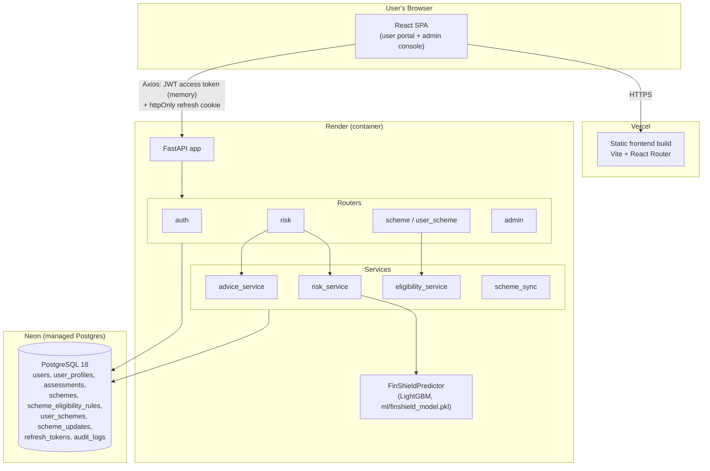
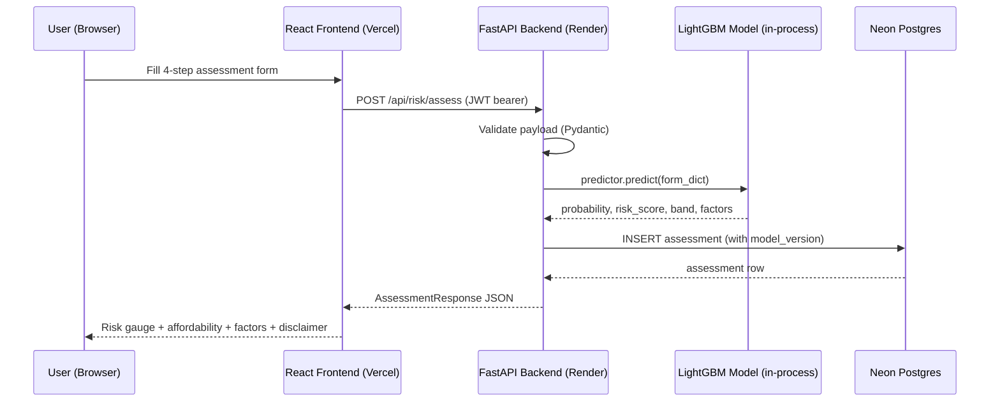
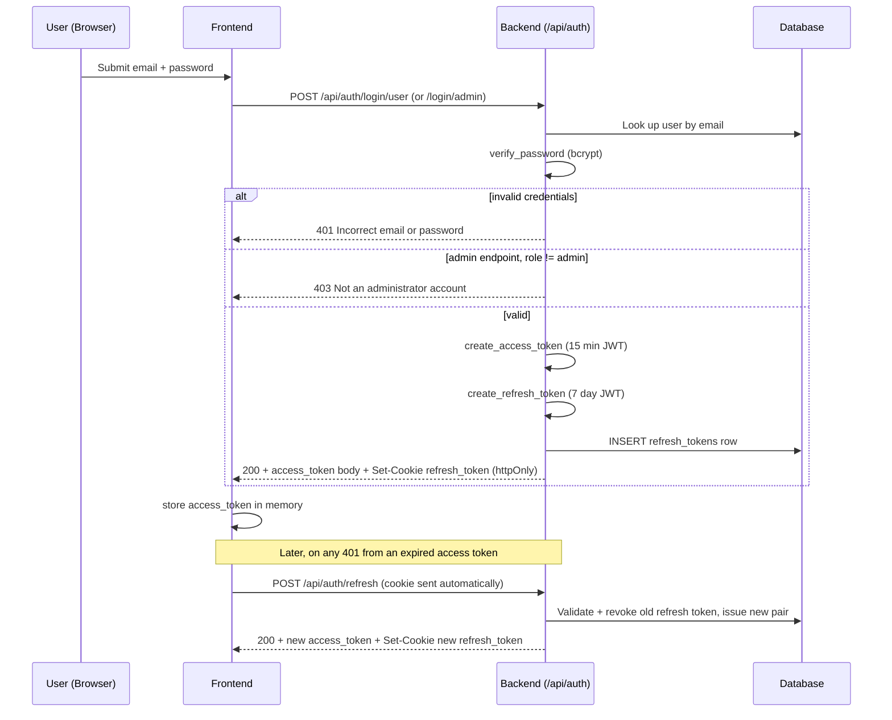

# FinShield — Master Reference for Documentation (Interim Report / Black Book / Project Report)

This file is a complete, verified reference to the FinShield project, written to
be handed to an AI assistant (or a person) who needs to produce formal academic
documentation — interim report, final "black book," synopsis, or any other
report format — without inventing facts. Every technical claim below was
checked against the actual source code, database schema, or live deployment.
Where something is incomplete or a known limitation, it is stated honestly
rather than rounded up, because a report that overclaims is a worse outcome
than one that is precise about partial work.

**Instruction to whichever AI is given this file**: use only the facts in this
document. Where you need content this file doesn't contain (literature survey
citations, a specific formatting template your institute requires, the
author's name/roll number/college name, submission date), ask the user rather
than inventing it. Do not invent performance numbers, dataset sizes, citation
titles, or screenshots — the user will supply or capture those separately.

---

## 1. Project Identity

- **Project title**: FinShield — AI-Based Financial Risk Assessment and
  Government Welfare Scheme Recommendation System
- **Domain**: FinTech / Financial Inclusion, applied Machine Learning,
  E-Governance.
- **Type of project**: Full-stack web application (not a research-only ML
  notebook) — a deployed, usable system with a persistent database, real
  authentication, and a live frontend/backend split across cloud hosts.
- **Core idea**: one application solving two related but independent problems
  for a financially underserved user:
  1. *Opacity of credit risk* — most people have no way to see an estimate of
     their own credit risk before applying for a loan. FinShield gives an
     ML-generated, explainable estimate instead of a black-box bank decision.
  2. *Under-discovery of government welfare schemes* — India runs 500+
     central and state welfare schemes, but awareness and eligibility
     matching are poor. FinShield matches a user's own profile against a
     curated set of real schemes and links directly to the official
     application portal.
- **Why these two together**: both target the same underserved user
  (someone assessing their financial standing), and both are framed as
  *decision-support*, not decision-making — the app never approves a loan or
  submits a government application; it informs and links out.

---

## 2. Problem Statement

Individuals — particularly first-time borrowers, gig workers, and rural or
semi-urban applicants with thin credit files — lack two things:
1. Any visibility into how a lender's credit model might view their
   financial profile before they formally apply (and suffer a hard credit
   inquiry or rejection).
2. An easy way to discover which of the many Indian government welfare
   schemes they currently qualify for, since eligibility rules are scattered
   across hundreds of individual scheme pages and press releases.

FinShield addresses both with a single authenticated web app: a guided
assessment form that returns an ML-based risk indication, and a scheme
matching engine that runs against the same (or a lighter, login-free)
profile.

## 3. Objectives

1. Build a multi-step web form that collects the financial/demographic data
   needed for a credit-risk ML model, with proper client- and server-side
   validation.
2. Integrate a pre-trained LightGBM classifier to produce a default-risk
   probability, a FICO-style risk score, a risk band, and human-readable
   explanatory factors — without retraining or altering the model.
3. Build a rules-based eligibility engine that matches a user profile against
   a database of real government welfare schemes and ranks the matches.
4. Implement secure authentication with separate login surfaces for regular
   users and administrators, using industry-standard JWT + refresh-token
   session handling.
5. Give administrators a console to manage the scheme dataset's lifecycle
   (draft → needs_review → active → archived) so scheme data quality is
   maintained over time rather than being a static seed file.
6. Deploy the system to the public internet on production-grade hosting
   (not just `localhost`), and verify it with automated tests against the
   live deployment, not only a local dev environment.

## 4. Scope

**In scope**: the ML-based risk assessment flow; the scheme discovery and
matching flow; user and admin authentication; an admin console for scheme
data management; automated backend tests and an API-level smoke test;
deployment to a live, publicly reachable URL.

**Explicitly out of scope** (stated up front, not a late excuse):
- Payment processing of any kind.
- Real government portal API integration — the app links to the scheme's
  official application page rather than submitting an application itself.
- SMS/OTP delivery.
- A native mobile application (the frontend is a responsive web SPA only).
- Retraining or modifying the ML model — the model file is treated as a
  frozen, externally-supplied artifact (see Section 8).

---

## 5. System Architecture

| Layer | Technology | Notes |
|---|---|---|
| Frontend | React 19 + Vite | Plain JavaScript (`.jsx`), **no TypeScript** |
| Styling | Plain CSS Modules | No Tailwind, no Bootstrap, no Material UI — a deliberate project constraint |
| Routing | React Router v7 | Client-side SPA routing |
| HTTP client | Axios 1.20 | Interceptor handles silent access-token refresh on 401 |
| Charts | Recharts 3.10 | Used for the risk gauge / result visualizations |
| Backend | Python 3.11, FastAPI | Async-capable REST API, Pydantic v2 for validation |
| ORM | SQLAlchemy 2.0 | Declarative models, see Section 7 |
| Migrations | Alembic | Schema versioning |
| Database | PostgreSQL 18 | Hosted on **Neon** (serverless managed Postgres) |
| Auth | JWT (PyJWT) + bcrypt | 15-minute access tokens, 7-day httpOnly refresh-token cookies, bcrypt password hashing (pinned to `bcrypt==4.0.1` — see Section 11) |
| Rate limiting | slowapi | Per-route limits, e.g. 5/min on register, 10/min on login |
| ML runtime | LightGBM 4.7.0 | Loaded in-process inside the FastAPI app, not a separate microservice |
| Testing | pytest + httpx (backend), a zero-dependency Node smoke-test script (API-level) | See Section 12 |

### 5.1 Deployment topology

- **Frontend** → **Vercel** (static build, `finshield-three.vercel.app`)
- **Backend (FastAPI + ML)** → **Render** (container-based web service,
  `finshield-backend-4un4.onrender.com`)
- **Database** → **Neon** (managed, serverless Postgres)

Three independently hosted, independently scalable pieces communicating over
HTTPS.

**Why the backend is on Render, not Vercel — a real architectural decision
worth documenting, not a footnote.** The backend was originally deployed to
Vercel and failed outright: every request returned
`500 FUNCTION_INVOCATION_FAILED`. Root cause, diagnosed from the actual
deployment logs: Vercel serverless functions have a hard 250MB unzipped size
cap, and this backend's ML dependency stack alone (`lightgbm` + `pandas` +
`scikit-learn` + `numpy` + `scipy`) totals roughly 256MB — before FastAPI,
SQLAlchemy, or anything else is even counted. Vercel's serverless-function
model is architecturally unsuited to a Python service that bundles a real ML
runtime. Render was chosen instead specifically because it runs a normal
long-lived container with no such artificial size ceiling. This is presented
in the report as a diagnosed constraint and a justified tool choice, not as
"we deployed it and it didn't work the first time."

**Cross-site cookie handling.** Because the frontend (Vercel) and backend
(Render) are different registrable domains, the refresh-token cookie's
`SameSite` attribute matters: `SameSite=Lax` (the safe local-dev default) is
never attached by browsers to a cross-site XHR/fetch call, which silently
broke session refresh in production until the cookie attributes were made
configurable (`COOKIE_SECURE=true`, `COOKIE_SAMESITE=none` in production,
`false`/`lax` in local dev) — see Section 11, item 8.

### 5.2 Authentication design

Three login endpoints share two internal helpers (`_authenticate`,
`_issue_session`) in `backend/app/routers/auth.py`:

- `POST /api/auth/login` — role-agnostic; retained only because it is the
  OAuth2 `tokenUrl` that FastAPI's own dependency-injection security scheme
  expects internally.
- `POST /api/auth/login/user` — the customer-facing portal login. Accepts
  any active account, including admin accounts (an admin is also a user and
  can use the regular dashboard).
- `POST /api/auth/login/admin` — the admin console login. Returns `403` if
  the authenticated account's role is not `admin`. Deliberately checks the
  password *before* the role check, so an incorrect password always returns
  `401` regardless of role — this prevents the endpoint's response from
  leaking whether a given email belongs to an admin account.

Session mechanics: a 15-minute JWT access token (kept in frontend memory, not
localStorage, to limit XSS exposure) plus a 7-day refresh token stored
**both** as an httpOnly cookie (inaccessible to JavaScript) and as a database
row in `refresh_tokens` (so a token can be explicitly revoked server-side on
logout or rotation, not just left to expire). On every refresh, the old
token is marked `revoked=True` and a new one is issued (rotation, not reuse).

The frontend exposes two separate login surfaces, `/login` and
`/admin/login`, implemented as one shared `Auth.jsx` component switched by a
`mode` prop — not two duplicated pages.

### 5.3 Architecture diagrams

**Component / deployment view:**



**Risk-assessment request sequence:**



**Authentication / session sequence** (useful for a "Login Module" design
diagram in the report):



---

## 6. Technology Justification (for a "System Requirements" / "Feasibility" chapter)

- **FastAPI over Flask/Django**: native async support, automatic OpenAPI
  schema generation (`/docs`), and first-class Pydantic v2 integration for
  request/response validation — directly useful for a form-heavy app with a
  strict model input contract (Section 8.3).
- **React + Vite over Create React App**: Vite's dev server and build are
  materially faster; CRA is effectively unmaintained upstream.
- **Plain CSS Modules over a CSS framework**: a project constraint (see
  `AGENTS.md` in the repo) to keep the frontend dependency-light and to force
  deliberate, from-scratch design-token decisions (documented color/spacing
  variables) rather than relying on a framework's defaults.
- **PostgreSQL over MySQL/SQLite in production**: native `JSONB` columns
  (used for `input_data`, `affordability`, `factors`, eligibility rule
  `value`, and `changes` in the audit log) and proper `UUID` primary keys.
  SQLite is used only as an isolated, fast backend for the automated test
  suite (Section 12), never in production.
- **Neon over a self-managed Postgres instance**: serverless, scales to
  zero, no server to patch or back up manually — appropriate for a student
  project's budget and operational capacity.
- **LightGBM over logistic regression or a deep model**: gradient-boosted
  trees handle the mixed categorical/numeric tabular features in this
  domain well, train fast, and — critically for this project — the model
  was supplied pre-trained and is treated as a fixed, frozen artifact, so the
  choice of algorithm itself is inherited, not re-derived; see Section 8.
- **JWT + httpOnly refresh cookie over a single long-lived token**: limits
  the exposure window of a stolen access token (15 minutes) while the
  refresh token — the more sensitive, longer-lived credential — is
  inaccessible to any JavaScript on the page (httpOnly), mitigating XSS
  token theft.

---

## 7. Database Design

Nine tables, all UUID-keyed. This is the actual, current SQLAlchemy schema —
suitable for direct inclusion as an ER diagram or schema table in the report.

### 7.1 Entities

**`users`**
| Column | Type | Notes |
|---|---|---|
| id | UUID, PK | |
| email | String, unique, indexed | |
| phone | String, nullable | |
| full_name | String, nullable | |
| password_hash | String | bcrypt hash, never the plaintext |
| role | Enum(`user`, `admin`) | default `user` |
| is_verified | Boolean | |
| is_active | Boolean | default True; `_authenticate` rejects login if False |
| created_at / updated_at | DateTime (tz-aware) | |

**`user_profiles`** (1:1 with `users`)
| Column | Type | Notes |
|---|---|---|
| id | UUID, PK | |
| user_id | UUID, FK → users.id, unique | |
| date_of_birth | Date, nullable | |
| gender | String, nullable | |
| state / district | String, nullable | for scheme matching by geography |
| area_type | Enum(`rural`, `urban`) | |
| occupation_tags | JSON, nullable | |

**`refresh_tokens`**
| Column | Type | Notes |
|---|---|---|
| id | UUID, PK | |
| token | String, unique, indexed | the JWT string itself |
| user_id | UUID, FK → users.id | |
| expires_at | DateTime (tz-aware) | |
| revoked | Boolean | flipped True on rotation/logout |
| created_at | DateTime | |

**`assessments`**
| Column | Type | Notes |
|---|---|---|
| id | UUID, PK | |
| user_id | UUID, FK → users.id | |
| created_at | DateTime | indexed together with user_id, DESC, for fast "recent reports" queries |
| input_data | JSONB | the full form submission, for traceability |
| default_probability | Float | raw model output |
| risk_band | String | one of the model's 5 bands |
| risk_score | Integer | 300–850 |
| population_percentile | Float | |
| affordability | JSONB | grade, surplus, ratios, flags |
| factors | JSONB | positive/negative plain-language drivers |
| model_version | String | **every stored prediction records the model version**, per the project's traceability rule |

**`schemes`**
| Column | Type | Notes |
|---|---|---|
| id | UUID, PK | |
| name / slug | String | slug is unique, used in the scheme-detail URL |
| short_description / full_description | String / Text | |
| ministry | String, nullable | |
| category | Enum(`education`, `health`, `agriculture`, `business`) | |
| level | Enum(`central`, `state`) | |
| state | String, nullable | only set for state-level schemes |
| benefit_type | Enum(`cash`, `subsidy`, `insurance`, `loan`, `other`) | |
| benefit_amount | Numeric, nullable | |
| official_url | String | the real government link the user is sent to |
| required_documents | JSONB | |
| status | Enum(`draft`, `active`, `archived`, `needs_review`) | governs visibility — only `active` is ever returned to end users |
| source_url | String, nullable | where the scheme data was sourced from, for auditability |
| last_synced_at | DateTime, nullable | |

**`scheme_eligibility_rules`**
| Column | Type | Notes |
|---|---|---|
| id | UUID, PK | |
| scheme_id | UUID, FK → schemes.id | |
| field | String | which profile/assessment field this rule checks |
| operator | Enum(`eq`,`neq`,`lt`,`lte`,`gt`,`gte`,`between`,`in`,`not_in`) | |
| value | JSONB | the comparison value(s) |
| logic_group | Integer | rules in the same group are AND'ed; groups are OR'ed across each other |

**`user_schemes`**
| Column | Type | Notes |
|---|---|---|
| id | UUID, PK | |
| user_id | UUID, FK → users.id | |
| scheme_id | UUID, FK → schemes.id | |
| status | Enum(`saved`,`documents_ready`,`applied`,`under_review`,`approved`,`rejected`) | user's own tracked progress |
| notes | Text, nullable | |
| application_number | String, nullable | |
| *(unique constraint on user_id+scheme_id — a user can only track a given scheme once)* | | |

**`scheme_updates`**
| Column | Type | Notes |
|---|---|---|
| id | UUID, PK | |
| scheme_id | UUID, FK → schemes.id | |
| detected_at | DateTime | |
| source_url | String, nullable | |
| field_changes | JSONB | what changed |
| status | Enum(`pending`,`approved`,`rejected`) | admin review queue for scheme data drift |
| reviewed_by | UUID, FK → users.id, nullable | |

**`audit_logs`**
| Column | Type | Notes |
|---|---|---|
| id | UUID, PK | |
| actor_id | UUID, FK → users.id, nullable | who did it |
| action | String | e.g. "scheme.status_changed" |
| entity_type / entity_id | String | what was acted on |
| changes | JSONB, nullable | |
| ip_address | String, nullable | |

### 7.2 Relationships (for an ER diagram)

- `users` 1—1 `user_profiles`
- `users` 1—N `assessments`
- `users` 1—N `refresh_tokens`
- `users` 1—N `user_schemes` N—1 `schemes` (many-to-many between users and
  schemes via the `user_schemes` join table, which also carries per-user
  state)
- `schemes` 1—N `scheme_eligibility_rules`
- `schemes` 1—N `scheme_updates`
- `users` 1—N `audit_logs` (as actor)

---

## 8. The Machine Learning Module

### 8.1 Position in the system

The ML model is a **pre-trained, frozen artifact** (`ml/finshield_model.pkl`)
loaded once at backend startup and served in-process inside the FastAPI
application — not as a separate microservice. It is explicitly never
retrained, refit, or modified as part of this project's engineering work;
the project's own `AGENTS.md` instructions state this as a hard rule,
because the 700MB training dataset is not present in the repository and
cannot be regenerated in this environment. **This is an important, honest
scoping statement for the report**: the contribution of this project is the
*system* built around the model (data pipeline, API contract, explainable
output, UI, affordability analysis, the self-check in Section 8.5) — not the
training of the model itself. State this plainly rather than implying the
model was trained as part of this capstone, unless you in fact also did the
training work separately (`step1_*.py`–`step4_*.py` scripts exist in the
repo for that original training process, kept for academic reproducibility,
but they require source CSVs not included here and are never run as part of
the live application).

### 8.2 Algorithm and training details

- **Algorithm**: Gradient-boosted decision trees via LightGBM's
  `LGBMClassifier`.
- **Hyperparameters**: 322 boosting rounds (estimators), 48 leaves per tree,
  learning rate 0.03, binary classification objective.
- **Training data**: 307,511 rows. Population base default rate: 8.07%.
- **Performance metrics**:

  | Metric | Value | Plain-language meaning |
  |---|---|---|
  | AUC (ROC) | 0.685 | Probability the model ranks a random defaulter as riskier than a random non-defaulter, better than chance (0.5) but moderate by production credit-scorecard standards (0.75+ is typical in deployed scorecards) |
  | Gini coefficient | 0.371 | Equivalent to `2×AUC − 1`; a standard credit-scoring discrimination metric |
  | KS statistic | 0.271 | Maximum separation between the cumulative good/bad distributions |
  | Brier score | 0.071 | Mean squared error of the predicted probability — lower is better; a well-calibrated model with low error |

  **State this honestly in the report**: AUC 0.685 reflects moderate, not
  strong, discrimination. The in-app disclaimer (every result includes one)
  exists specifically because of this — framing the output as an indicative
  estimate, never a credit decision.

### 8.3 Features

21 raw fields are collected from the user via the 4-step form and sent to
the API:

```
age, gender, education, marital_status, dependents, employment_status,
years_employed, annual_income, monthly_emi, existing_total_debt, asset_value,
monthly_expenditure, savings, owns_vehicle, owns_property, has_prior_credit,
has_defaulted, payment_history, n_prior_credits, n_active_credits,
years_credit_history
```

These are transformed by `finshield_predictor.py`'s frozen feature
engineering into **24 engineered features**, including derived ratios such
as `DTI`, `DEBT_TO_INCOME`, `INCOME_PER_HEAD`, `INCOME_PER_YEAR_WORKED`,
`EMPLOYMENT_RATIO`, plus categorical encodings of gender, education, marital
status, employment status, and payment history. Dropdown option values are
served by `GET /api/risk/schema` so the frontend never hardcodes a
mismatched set of valid category values (a mismatch here was in fact one of
the real bugs fixed — see Section 11, item 1).

### 8.4 Output contract

`FinShieldPredictor.predict(form_dict)` returns exactly this shape, and the
frontend renders these fields and no invented ones:

```json
{
  "default_probability": 0.0942,
  "risk_band": "Moderate",
  "risk_score": 641,
  "population_percentile": 62.0,
  "affordability": {
    "grade": "Stretched",
    "monthly_surplus": 12000.0,
    "surplus_ratio": 0.16,
    "emi_to_income_ratio": 0.42,
    "emergency_fund_months": 2.8,
    "flags": ["EMIs are above the 40% comfort threshold"]
  },
  "factors": {
    "positive": ["Stable employment record"],
    "negative": ["Existing EMIs consume a large share of income"]
  },
  "model_meta": {
    "auc": 0.6853,
    "trained_on": 307511,
    "population_default_rate": 0.0807
  }
}
```

- `risk_score`: a 300–850 linear rescale of the default probability onto a
  FICO-style range: `risk_score = 300 + (1 - probability/0.5) * 550`,
  clamped to `[300, 850]`. Higher score = lower risk (safer).
- `risk_band`: one of **five** bands — Very Low, Low, Moderate, High, Very
  High — determined by fixed probability cutoffs baked into the model
  (`[0.0657, 0.1039, 0.1525, 0.2108]`). The **frontend** collapses these to
  **three** display bands (Low = Very Low+Low, Medium = Moderate, High =
  High+Very High) purely for UI simplicity. This collapsing happens only in
  the frontend; the model's own five-band output is never altered, logged,
  or stored differently — an explicit project rule.
- `affordability`: a **separate, deterministic heuristic** (not part of the
  ML model's output) computed from the same inputs — monthly surplus,
  surplus ratio, EMI-to-income ratio, emergency-fund-months, and flags. It
  is important in the report to describe this as a distinct signal from the
  ML risk band: a user can have a "Low" ML risk band (low modeled default
  probability) while still showing a "Stretched" affordability grade, because
  the two measure different things (statistical default likelihood vs.
  simple cash-flow headroom). This is intentional, not a bug — worth a
  sentence in a "Discussion" or "Limitations" section to pre-empt a reviewer
  reading it as an inconsistency.

### 8.5 Integrity safeguard

A startup self-check runs a fixed sample input through the loaded model on
every backend boot and logs a critical error if the output drifts from a
known expected value (`0.0232`). This exists to catch a dependency version
mismatch (e.g. a different LightGBM version loaded, which can silently
change prediction outputs without raising any exception) corrupting live
predictions — worth including in a report as evidence of production
engineering discipline around a third-party ML artifact, not just "the model
works."

---

## 9. Scheme Recommendation Engine

### 9.1 Design

- Each scheme's eligibility is defined by rows in `scheme_eligibility_rules`:
  `(field, operator, value, logic_group)`.
- Rules sharing a `logic_group` combine with **AND**; separate groups combine
  with **OR** — so a scheme can express multiple independent eligibility
  paths (e.g. "SC/ST applicants OR women entrepreneurs OR annual income below
  ₹X").
- `evaluate_scheme` / `rank_schemes` in `eligibility_service.py` perform the
  evaluation against a user's profile/assessment data and return a ranked
  list.

### 9.2 Endpoints

- `GET /api/schemes` — list active schemes (filterable).
- `GET /api/schemes/{slug}` — scheme detail.
- `POST /api/schemes/match` — full-profile matching for logged-in users
  (uses assessment data for richer matching).
- `POST /api/schemes/quick-match` — a lighter match that works **without
  login** and with fewer fields — this is specifically what satisfies the
  project rule that scheme browsing must work even if the ML/assessment
  pipeline is unavailable or the user hasn't registered.
- `GET /api/schemes/{id}/eligibility` — explicit eligibility breakdown for
  one scheme.
- `user_scheme` router (`GET/POST /api/user-schemes`,
  `PATCH /api/user-schemes/{id}`) — lets a logged-in user save a scheme and
  track their own application status (`saved` → `documents_ready` →
  `applied` → `under_review` → `approved`/`rejected`).
- Admin router: `GET/POST/PUT/DELETE /api/admin/schemes`,
  `POST /api/admin/schemes/import`, `GET /api/admin/scheme-updates`,
  `POST /api/admin/scheme-updates/{id}/{action}`, `GET /api/admin/users`,
  `PATCH /api/admin/users/{id}`, `GET /api/admin/audit-logs`,
  `GET /api/admin/analytics`, `GET /api/admin/stats`.

Every scheme card links directly to the scheme's real `official_url` — the
application itself always happens on the actual government portal, by
design (see Section 4, Out of Scope).

### 9.3 Data integrity status — the honest, current bottleneck

| Status | Count | Meaning |
|---|---|---|
| `active` (visible to users) | 8 | Real, individually sourced and verified schemes |
| `needs_review` (built, not yet visible) | 11 | Real schemes sourced from official government sources (PIB press releases, ministry sites), pending admin review before being set `active` |
| `archived` | 17 | **Removed fabricated placeholder data** — see below |

**This is a genuine and important part of the project's story, not a gap to
hide.** The project originally shipped with 17 fake "State Welfare Scheme
9–25" entries: invented benefit amounts, a generic placeholder URL, and
descriptions that literally read "This is a placeholder," live in production
and shown to real users as if they were real schemes. These were identified
during this development cycle and archived (status flipped to `archived`,
not deleted, preserving the audit trail). Eleven replacement schemes were
then individually sourced from official Indian government press releases
(pib.gov.in) rather than generated from memory, specifically to avoid
repeating the same mistake — each has a real eligibility basis and a real
official application link, held at `needs_review` pending admin sign-off
before going live.

Currently **active** (sourced from the original, legitimate part of the seed
data): PM-KISAN, PMAY (Urban), Sukanya Samriddhi Yojana, Atal Pension Yojana,
PM Mudra Yojana, NSP Post-Matric Scholarship, Ayushman Bharat (PM-JAY),
Stand-Up India.

Currently **sourced, pending review**: PM Ujjwala Yojana, PMJJBY, PMSBY, PM
Fasal Bima Yojana, PM Vishwakarma, PMEGP, PM SVANidhi, NMMSS (National
Means-cum-Merit Scholarship), PMMVY (Matru Vandana Yojana), PM Jan Dhan
Yojana, Pre-Matric Scholarship for SC students.

**For the report**: present the `draft → needs_review → active → archived`
lifecycle itself (enforced via the `status` enum and only `active` ever being
served to end users) as the actual deliverable here — a data governance
workflow, not just a static JSON seed file — and name the 8-vs-11-vs-hundreds
coverage gap explicitly as current, known, in-progress scope rather than
letting a reviewer discover the number is small on their own.

---

## 10. End-to-End User Flow (for a "Results" / "System Testing" / "Output" chapter)

1. **Registration/Login**: a user registers or logs in via `/login` (regular
   portal) or an administrator via `/admin/login` — two distinct pages built
   from one shared `Auth.jsx` component.
2. **Assessment wizard**: a 4-step form —
   (1) Personal details → (2) Employment & assets → (3) Finances
   (conditional: EMI/loan-balance fields only appear if the user indicates
   they have active loans) → (4) Credit history. Inline client-side
   validation and hover/focus tooltips explain less-obvious fields; all
   validation is re-checked server-side regardless (client validation is a
   convenience only, per project rules).
3. **Submission**: `POST /api/risk/assess` sends the validated payload with a
   JWT bearer token. The backend validates with Pydantic, runs the frozen
   LightGBM model, persists an `assessments` row (with `model_version` for
   traceability), and returns the full prediction payload in the same
   response.
4. **Risk Result screen**: a 300–850 gauge visualization with a collapsed
   3-band color label (Low/Medium/High), the raw default probability and
   population percentile ("safer than X% of a reference population of
   307,511 applicants"), the affordability breakdown, plain-language
   positive/negative factors, and a mandatory disclaimer naming FinShield's
   trained ML model and stating the result is an indicative estimate, not a
   credit decision or licensed financial advice.
5. **Scheme matches**: in the same flow (or independently, via quick-match
   without login), a ranked list of schemes the user currently qualifies
   for, each showing its eligibility basis and a link to the real official
   application portal.
6. **Reports/history**: a logged-in user can revisit past assessments
   (`GET /api/risk/assessments`, with a compare endpoint for viewing two
   side by side).
7. **Admin console**: a separate authenticated area where an admin manages
   the scheme dataset's lifecycle, reviews pending scheme-data-drift updates,
   manages user accounts, and can view audit logs and basic analytics/stats.

**One-line outcome statement for an abstract**: a single deployed web
application in which a user receives both an ML-backed, explainable
credit-risk indication and a personalized, linked list of government welfare
schemes they currently qualify for — two problems (credit opacity and
welfare-scheme under-discovery) addressed in one flow, each independently
usable even if the other component is unavailable.

---

## 11. Development Process — Problems Encountered and Resolved

A strong "Implementation" or "Testing" chapter benefits from documenting real
engineering problems and how they were diagnosed and fixed, not just listing
features built. These are all real, verified issues from this project's
actual development history:

1. **Form/API field-value mismatch silently rejected valid submissions.**
   The frontend sent `payment_history: "No History"`; the backend's enum
   only accepted `"no_history"`. Every user with no prior credit history had
   their submission rejected with a 422 before the ML model ever ran.
2. **That failure then crashed the entire page to a blank white screen**
   instead of showing a usable error. Root cause: FastAPI returns 422
   validation errors as a JSON array of error objects, and the frontend
   attempted to render that array directly as React children — which React
   refuses to do, throwing a render error. Fixed with a dedicated
   error-formatting helper (`describeSubmitError()`) that turns the array
   into readable text.
3. **The risk gauge showed a "Low Risk" label while the needle visually
   pointed toward the high-risk (red) end of the dial.** Diagnosed via the
   SVG rotation math: the needle's sweep direction was actually correct —
   the color gradient's stops were reversed. Fixed by swapping the
   gradient, not the needle logic.
4. **A committed secret.** An early commit included a real database
   connection string and JWT signing key inside a tracked `.env` file,
   pushed to a public GitHub repository. Resolved by rotating the exposed
   key, moving the file to a gitignored location, and adding a proper
   `.gitignore`.
5. **A reserved-TLD email trap.** An admin account seeded with a
   `.local`-domain email address could authenticate with correct
   credentials but every response then crashed with a 500, because
   Pydantic's `EmailStr` validator rejects reserved TLDs (`.local`, `.test`,
   `.example`) even during output serialization, not just input. Fixed by
   using real-domain emails and validating `ADMIN_EMAIL` explicitly before
   seeding.
6. **A `bcrypt`/`passlib` version incompatibility broke all logins** on a
   fresh production deployment. `bcrypt>=4.1` raises an exception on inputs
   over 72 bytes instead of silently truncating them (its previous
   behavior), which crashed `passlib==1.7.4`'s own internal self-test
   (`detect_wrap_bug`) the first time any password was checked. Diagnosed
   from the actual Render crash traceback, reproduced and fixed in an
   isolated virtual environment (pinning `bcrypt==4.0.1`) before
   redeploying.
7. **A per-user data leak in the browser.** The assessment wizard's
   in-progress draft (including income and debt figures) was stored under
   one global `localStorage` key shared by every account on the same
   browser — so logging in as a second user on a shared/kiosk-style browser
   would show the first user's unsaved financial data. Fixed by scoping the
   draft's storage key to the logged-in user's ID and explicitly clearing it
   on logout.
8. **Cross-site refresh-token cookie failure after multi-domain deployment.**
   Once the frontend (Vercel) and backend (Render) were on different
   registrable domains, the refresh-token cookie's `SameSite=Lax` attribute
   (correct for same-site local development) meant browsers would never
   attach it to the cross-site `POST /api/auth/refresh` call the frontend's
   axios interceptor makes automatically on a 401. This surfaced as a raw
   "Refresh token missing" error to users whose 15-minute access token
   expired mid-session (e.g., partway through the 4-step wizard). Fixed by
   making the cookie's `secure`/`samesite` attributes environment-driven
   (`COOKIE_SECURE`, `COOKIE_SAMESITE` settings), set to `true`/`none` in
   production and left at the safe `false`/`lax` defaults for local
   development — verified by inspecting the actual `Set-Cookie` response
   header after the production environment variables were applied.
9. **Vercel's 250MB function size cap** — covered in Section 5.1 — was
   diagnosed *before* a failed deploy attempt would have wasted more time,
   by reading Vercel's own documented limits against the measured size of
   the ML dependency stack.

---

## 12. Testing

- **Backend unit/integration tests**: a pytest suite of **20 tests**,
  covering registration, all three login endpoints, refresh-token rotation
  and revocation, role enforcement (admin vs. user), and risk-assessment
  submission — run against an isolated SQLite database so tests never touch
  production data.
- **API-level smoke test**: a standalone, zero-dependency Node.js script
  (`frontend/scripts/api-smoke-test.mjs`, run via `npm run test:api`) that
  issues real HTTP requests against a live backend URL (configurable via
  `VITE_API_URL`) and checks **46 cases** spanning auth, risk assessment,
  schemes, user-schemes, and admin routes — including negative cases
  (expected 401/403/422 responses), not just happy-path checks.
- **Verification discipline**: every bug fix listed in Section 11 was
  verified against the actual live production deployment (Render + Neon +
  Vercel) using real HTTP requests matching real request headers/cookies —
  not only a local reproduction — before being considered resolved.
- **If asked to show evidence**: a terminal screenshot of a clean run of
  both suites together (pytest's pass count + the smoke test's pass count
  visible in one screen) is a reasonable "Testing" chapter artifact; capture
  it fresh rather than reusing an old one, since the exact counts can change
  as the test suite grows.

---

## 13. Advantages

- Decouples two useful features (risk assessment, scheme discovery) so a
  failure or slowdown in one never blocks the other.
- Explainable output: every risk result includes plain-language positive/
  negative factors and a disclaimer, rather than a bare opaque number.
- A real content-governance workflow for scheme data (`needs_review` →
  `active`), not a static, unaudited seed file.
- Session design limits token exposure (short-lived access token in memory,
  httpOnly refresh cookie, server-side revocation on rotation/logout).
- Verified, not assumed: the project's test suite and bug-fix history show
  genuine engineering verification against a live deployment, not just local
  demos.

## 14. Limitations

- The ML model's AUC (0.685) is moderate by production-scorecard standards;
  it is explicitly presented to users as an indicative estimate, not a
  credit decision.
- The model's training dataset is a public proxy dataset (307,511 rows),
  not an India-specific credit dataset — a limitation worth naming directly
  rather than implying Indian-market specificity.
- Scheme coverage is currently small relative to the stated goal (8 active,
  11 pending review, against India's 500+ actual central/state schemes).
- No real government portal API integration — users are linked out to apply,
  by design, not as a shortcut.
- The model is a frozen artifact; this project could not retrain or validate
  it against fresh data within this environment.

## 15. Future Scope

- Expand verified scheme coverage well beyond the current 8/11, continuing
  the sourced-from-official-sources discipline rather than reverting to
  placeholder data.
- If a suitable India-specific labeled credit dataset becomes available,
  evaluate retraining (as a distinct, explicitly-scoped future project phase
  — not silently inside this one, per the frozen-model constraint).
- Add a UI-level clarifying note distinguishing the ML risk band from the
  separate affordability heuristic, since the two can legitimately diverge
  (Section 8.4) and a user without context could read that as a bug.
- Add more eligibility fields / profile richness to improve match precision
  for schemes with complex, multi-group eligibility logic.

## 16. Conclusion

FinShield is a deployed, tested, full-stack web application that combines an
ML-based financial risk assessment with a government welfare scheme
discovery engine, built on a conventional and well-justified technology
stack (React/Vite frontend, FastAPI backend, PostgreSQL via Neon, a
pre-trained LightGBM model). The project demonstrates not only feature
construction but a real development and hardening process — nine
substantive, independently diagnosed and fixed engineering problems (Section
11), automated test coverage at both the unit and live-API level (Section
12), and an honest, explicit accounting of current limitations (Section 14)
rather than overstated completeness. The two core modules are functionally
complete and independently usable; the primary remaining work is breadth —
expanding verified scheme coverage — rather than depth of engineering.

---

## 17. What You Still Need to Supply Yourself (not in this file)

- Your name, roll number/registration number, institute name, department,
  guide/mentor name, submission date, and your institute's specific report
  formatting template (chapter numbering style, font, margins) — these are
  administrative details this file cannot know.
- A real literature survey with actual citations. Do not let an AI invent
  paper titles or authors for this section — either supply real papers
  yourself, or have the AI search for real ones and clearly tell you which
  it found vs. couldn't verify.
- Screenshots of the live application. None are embedded in this file.
  Capture, using test/dummy accounts (never real users' financial data,
  per the project's own "never log financial values" rule): the landing
  page, the assessment wizard (showing the conditional loan fields), the
  Risk Result screen (gauge + disclaimer visible), a scheme match card
  (eligibility + official link visible), and the admin scheme-management
  table (status lifecycle visible).
- Any citation-style requirement (IEEE/APA/other) your department mandates
  for the References section.
